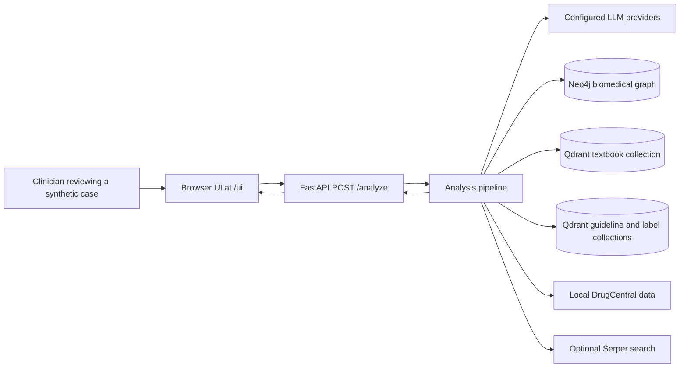
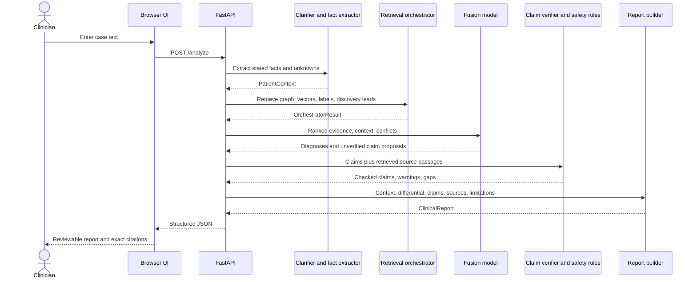
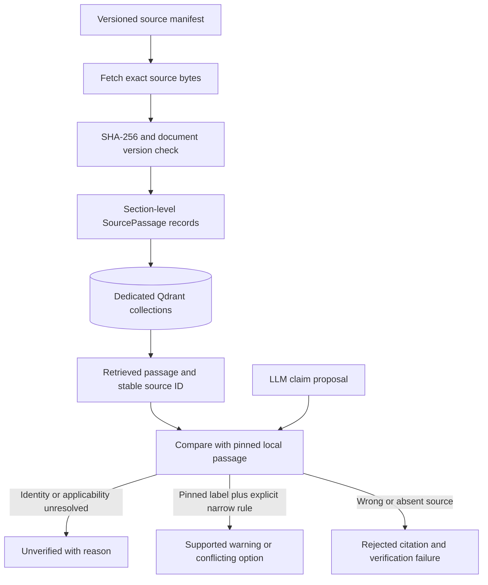
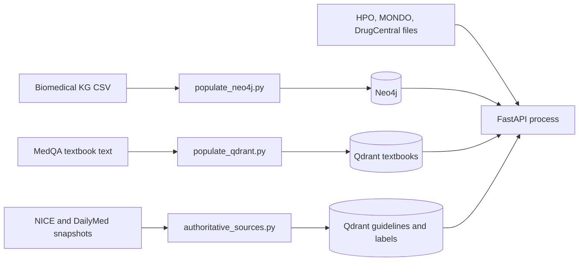

# Architecture and evidence boundaries

This document describes the implementation on the `claim-verification` branch. It is a research architecture for **clinician review of candidate findings**, not an autonomous diagnosis or prescribing system. The authoritative source set is deliberately limited to selected adult-hypertension recommendations and one amlodipine label. The code has broader graph and textbook retrieval, but those signals do not automatically verify a clinical claim.

For one consolidated figure spanning the runtime, ingestion, trust boundary, and evaluation, see [the detailed architecture diagram](ARCHITECTURE_DIAGRAM.md).

## 1. System view

The UI is static HTML/CSS/JavaScript served by `backend/main.py`. It submits the case text to the same-origin API and displays the structured `report`. The API builds service objects lazily on first analysis. `GET /health` checks only the API process. The full pipeline needs local ontology/DrugCentral files, populated Neo4j and Qdrant stores, pinned source snapshots, and at least one working LLM provider for useful synthesis.

| Boundary | Implementation | What crosses it |
| --- | --- | --- |
| UI to API | `frontend/app.js`, `backend/api/routes.py` | Free-text case in; patient context, retrieval counts, report out |
| API to LLMs | `backend/services/llm_fallback.py` | Case text and constructed prompts; configured providers are tried in order |
| API to local stores | Graph and vector retrievers, DrugCentral service | Normalized symptoms/medicines and retrieval queries |
| API to web discovery | `backend/services/evidence_scanner.py` | Optional search terms derived from symptoms and conditions; snippets are candidate leads only |
| Runtime to pinned sources | `ingestion/authoritative_sources.py`, `backend/services/claim_verifier.py` | Manifest, checksum-verified local snapshots, exact passage metadata and text |

The application is designed for local research use. It does not implement authentication, audit logging, encryption policy, or a governed process for identifiable patient data. Configured LLM providers receive case content; use synthetic or appropriately de-identified inputs in demonstrations.

## 2. Request path

1. **Clarification and anchoring.** `ClinicalClarifier` asks an LLM for structured entities, then `patient_fact_extractor.py` checks clinically important statements against the original text. `OntologyParser` and `EntityLinker` normalize terms with local HPO, MONDO, and drug-name data. `PatientContext` carries explicit allergy/medication states and missingness. Extraction is fallible: the synthetic unknown-allergy case exposed an erroneous allergy mention, so a source phrase is not equivalent to clinician-confirmed history.
2. **Retrieval.** `RetrievalOrchestrator` calls `GraphRetriever` (Neo4j), `VectorRetriever` (Qdrant textbooks and separate authoritative collections), `DrugCentralService`, and optional Serper discovery. `OrchestratorResult` keeps graph candidates, textbook evidence, and authoritative `SourcePassage` records distinct. Serper snippets and graph edges are not eligible as verified citations.
3. **Evidence ranking and conflict signals.** `EvidenceRanker` orders candidate graph/vector/DrugCentral items heuristically. `ConflictDetector` flags graph associations and incomplete demographics as leads or gaps. Its medication-safety path later applies a small set of pinned-label rules.
4. **Claim proposals.** `ClinicalFusion` asks an LLM for ranked diagnoses and separate diagnosis, investigation, and conditional treatment claims. `claim_synthesis.py` normalizes source IDs, keeps supporting/conflicting/unverified buckets separate, and rejects invented or non-authoritative citation IDs. All new model claims begin `unverified`.
5. **Independent gate.** `ClaimVerifier` reloads local source snapshots, checks their SHA-256 and document version against the manifest, and requires the retrieved `SourcePassage` to match the pinned passage. It rejects missing or wrong IDs and some mismatched source topics, population, or source types. It does **not** infer general semantic entailment or patient-specific treatment eligibility from matching text; ambiguous claims remain `unverified`. The safety detector can mark only narrow amlodipine allergy and amlodipine–simvastatin findings as source-backed when the exact label passage and explicit patient facts are present. Unknown data produces a warning or abstention, never a safety clearance.
6. **Retry and report.** `ConfidenceEvaluator` computes a legacy heuristic used for up to two retries by default. It is **not a calibrated diagnostic probability**. Retry expansion retains the original case text as the extraction anchor. `ReportGenerator` assembles the differential, claims, medication safety, exact passages, missing checks, and verification failures. The UI hides the legacy percentage and renders claim status and dated source links.

The API retains legacy `ranked_diagnoses` and `overall_confidence` fields for compatibility. For evidence review, use `report.differential`, `report.claims`, `report.source_passages`, `report.medication_safety`, and `report.verification_failures`. Typed contracts are in `backend/schemas/`.

## 3. Source and claim lifecycle

`sources/hypertension/manifest.json` identifies the publisher, URL, jurisdiction, document/version/date, section list, local path, and SHA-256 for each citable source. `ingestion.authoritative_sources` parses 17 selected NICE recommendation passages and 9 amlodipine-label passages in the current local snapshot and indexes them in separate Qdrant collections. Source IDs derive from document identity, version, section, span, and passage hash; they are stable across runs using the same snapshot. The raw downloaded documents are ignored by Git because upstream rights and freshness need separate review.

The current manifest contains [NICE NG136 recommendations](https://www.nice.org.uk/guidance/ng136/chapter/Recommendations) for England and a [DailyMed amlodipine SPL label](https://dailymed.nlm.nih.gov/dailymed/lookup.cfm?setid=0c5784b9-5542-144f-e063-6394a90a7ebc) for the United States. These are publisher-specific documents, not interchangeable worldwide “standards.” A host such as NCBI or DailyMed does not itself validate a recommendation: the exact underlying document, version, section, and applicability must be recorded. Independent clinician review of the selected corpus is pending.

### Contract and trust rules

| Item | Role in the current system | Can make a generic claim `supported`? |
| --- | --- | --- |
| Neo4j relation | Candidate disease/contraindication signal | No |
| Textbook vector hit | Context for synthesis | No |
| DrugCentral target relation | Candidate pharmacology signal | No |
| Serper snippet | Discovery lead | No |
| Pinned NICE passage | Exact, dated candidate citation | No; semantic and patient applicability still need clinician review |
| Pinned amlodipine label | Exact, dated candidate citation | Only the two narrow, explicit safety rules described above |

`ClinicalClaim` stores `claim_type`, `applies_to`, `conditions`, `missing_checks`, evidence ID buckets, `status`, and a reason when unverified. `ClinicalReport` validates that cited IDs resolve to included passages and that grouped claim IDs point to the correct type. A valid citation identity is a provenance check, not a clinical truth judgment.

## 4. Local data and deployment shape

The Neo4j importer reads a local `datasets/kg.csv` and defaults to 50,000 rows. The textbook importer currently reads one MedQA English textbook and indexes its first 150,000 characters. The authoritative importer checks source checksums before replacing its dedicated collections. `datasets/DATASET_GUIDE.md` lists required local paths and what is excluded from this public code repository. No real patient record or private API key should be committed.

## 5. Evaluation architecture and interpretation

`evaluation/run.py` reuses the production `/analyze` path while replacing only retrieval. The three arms are `llm_only`, `text_rag`, and `graph_text`; clarification is shared per case, mode order rotates, and web/DrugCentral retrieval is disabled in all arms. `evaluation/cases.v1.json` contains six synthetic engineering fixtures separate from indexed passages. The runner records dataset and source hashes, source dates, prompt hashes, configured and selected model IDs, Git state, latency, case-level errors, and a blinded review packet. The captured run can be rescored without another model call.

Exact alias top-k scores from the 2026-10-07 run were 1/6, 4/6, and 5/6. Those figures measure recognition of diagnoses already written in synthetic cases. Two cases used different synthesis providers across arms and one had unknown provider selection, so the comparison does not isolate retrieval effects. Pinned citation validity checks source identity; claim support accuracy and unsafe-option rate cannot be reported without independent clinician adjudication. See [evaluation/README.md](evaluation/README.md) for denominators and [SAMPLE_CASES.md](SAMPLE_CASES.md) for observed failures.

For publication, the implemented contribution is **traceable, conditional candidate presentation with explicit abstention in a narrow source domain**. Clinical accuracy, safe medicine recommendation, and patient benefit require stronger external validation and should not be inferred from this architecture or its synthetic fixtures.
