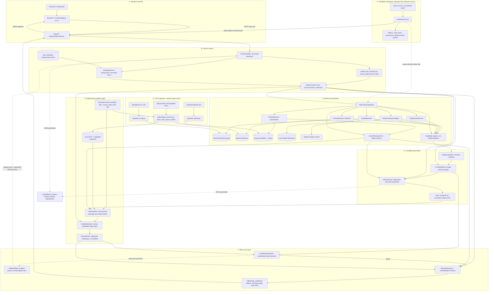

# Detailed architecture diagram

This diagram maps the implemented `/analyze` path, the two evidence trust levels, local data ingestion, and the synthetic evaluation harness. It represents the current research prototype; it does not imply clinical validation.

## Reading the diagram

1. **Solid arrows** show request data or local ingestion. **Dotted arrows** show external model calls, evaluation substitution, or the optional retry loop. The evaluation runner invokes the existing route function directly; it does not create a second production API.
2. **Candidate signals** from the graph, textbook retrieval, DrugCentral, and Serper can influence proposals but cannot make a claim `supported`. Only pinned `SourcePassage` records are eligible for citation. Their IDs and full passage data must match the manifest-backed local snapshot.
3. **The independent gate** leaves general diagnostic, investigation, and treatment proposals `unverified` when semantic support or patient applicability cannot be established. Explicit, narrow amlodipine safety rules can create a source-backed warning or a conflicting treatment claim. An absent source or unknown patient fact leads to a gap or abstention.
4. **The confidence value** controls retries and is not a calibrated probability. The UI presents statuses and missing checks; clinicians must assess the report and sources. Raw case text is sent to configured LLM providers, so the local prototype should be demonstrated with synthetic or appropriately de-identified inputs.

For file-level explanations and source limitations, see [ARCHITECTURE.md](ARCHITECTURE.md). For copyable inputs and observed failure cases, see [SAMPLE_CASES.md](SAMPLE_CASES.md).
