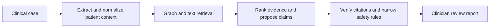

# Evidence-linked Graph-RAG clinical decision support prototype

A clinician-facing **research prototype** that turns a free-text case into a differential, conditional investigations and treatment options, medication-safety findings, and claim-level source links. It combines a biomedical knowledge graph, text retrieval, and a small pinned set of guideline and drug-label passages. Its current authoritative-source scope is **adult hypertension and one amlodipine label**. It is not validated for diagnosis, prescribing, clinical safety, or patient use.

The contribution being tested is an **evidence-linked claim workflow**: the model proposes claims, while a separate verifier checks source identity and narrow applicability rules. A linked source is not, by itself, proof that a clinical claim is true or appropriate for a patient. Most generated claims remain `unverified`; the only automatically supported findings are narrow, rule-checked warnings from the pinned amlodipine label.

## What the project contains

- A FastAPI endpoint (`POST /analyze`) and a browser interface (`/ui`) for clinician review.
- Extraction of stated patient facts and missing information, including allergy status, current medicines, blood pressure, selected labs, pregnancy status, and known hypertension.
- Retrieval from Neo4j graph relations, Qdrant textbook passages, and separately indexed versioned NICE and DailyMed passages. DrugCentral associations and optional Serper snippets contribute candidate signals, not verified citations.
- Typed diagnosis, investigation, treatment, and medication-warning claims with `supported`, `conflicting`, or `unverified` status, source IDs, conditions, and missing checks.
- A six-case synthetic safety/boundary evaluation, a separate 12-case four-condition diagnostic pilot, and a checksum-locked 36-vignette MedQA exam pilot comparing LLM-only, text-RAG, and graph-plus-text modes. Separate frozen challenges test 108 developer-labeled amlodipine scenarios and 132 constructed provenance corruptions.

See the [detailed architecture diagram](ARCHITECTURE_DIAGRAM.md) and [architecture explanation](ARCHITECTURE.md), [SAMPLE_CASES.md](SAMPLE_CASES.md) for copyable inputs, and [evaluation/README.md](evaluation/README.md) for metric definitions.

A [research manuscript draft](paper/MANUSCRIPT.md) describes the implementation and exploratory evaluations. The [six-case snapshot](paper/RESULTS_SNAPSHOT.json), [synthetic pilot snapshot](paper/MULTIDISEASE_PILOT_RESULTS.json), [MedQA exam-pilot snapshot](paper/MEDQA_EXAM_PILOT_RESULTS.json), [pinned-source retrieval snapshot](paper/RETRIEVAL_PROBE_RESULTS.json), [safety snapshot](paper/MEDICATION_SAFETY_TEST_RESULTS.json), and [provenance snapshot](paper/PROVENANCE_TAMPER_RESULTS.json) preserve counters and provenance hashes. The [MedQA selection manifest](evaluation/medqa_selection.v1.json) records the external exam-pilot protocol; raw questions and generated reports remain local. The manuscript does not claim clinical validation.

The [detailed paper draft following the supplied Neural Networks section template](paper/NEURAL_NETWORKS_PAPER_DRAFT.md) expands the methodology, dataset, results, discussion, references, and supplementary reproducibility notes. Author and declaration fields remain for the actual contributors to complete.

## Architecture at a glance



The verifier accepts only passages that match the pinned source manifest and local snapshot. Graph edges, textbook matches, DrugCentral targets, and web snippets can suggest what to examine, but cannot establish a supported treatment claim. Details of this trust boundary are in [ARCHITECTURE.md](ARCHITECTURE.md).

## Local setup

The repository contains code, a versioned source manifest, synthetic test cases, and the MedQA selection protocol. It **does not include** the large biomedical datasets, MedQA exam questions, Qdrant or Neo4j contents, or the raw NICE/DailyMed snapshots. You need the local inputs described in [datasets/DATASET_GUIDE.md](datasets/DATASET_GUIDE.md) to reproduce the full pipeline. Respect each source's reuse terms before obtaining or redistributing it.

1. Clone and install dependencies (the current local evaluation used Python 3.14):

   ```bash
   git clone https://github.com/Arnavmangarapu/CDSS_SDC2.git
   cd CDSS_SDC2
   python -m venv .venv
   source .venv/bin/activate
   pip install -r requirements.txt
   cp .env.example .env
   ```

   Put provider keys in the untracked `.env`. At least one configured LLM provider is recommended for useful synthesis. Without one, limited fallback extraction and graph-candidate output may still run. Never commit `.env` or real patient information.

2. Place the HPO, MONDO, biomedical graph, DrugCentral, and textbook files at the paths in the [data guide](datasets/DATASET_GUIDE.md). Start the local services and index the graph/text data:

   ```bash
   ./run_qdrant.sh
   ./run_neo4j.sh
   python ingestion/populate_neo4j.py --limit 50000
   python ingestion/populate_qdrant.py
   ```

   These scripts are for local development. They use a fixed local Neo4j password; change the credentials and deployment settings before using a shared environment. The Neo4j script imports 50,000 rows by default; the textbook script indexes only the first 150,000 characters of one MedQA textbook.

3. Fetch and index the pinned authoritative sources:

   ```bash
   python -m ingestion.authoritative_sources fetch
   python -m ingestion.authoritative_sources verify
   python -m ingestion.authoritative_sources ingest
   ```

   `fetch` requires an exact SHA-256 match to [the manifest](sources/hypertension/manifest.json). If an upstream page or label changed, review it and update the manifest/version instead of bypassing the check. The currently pinned sources are [NICE NG136](https://www.nice.org.uk/guidance/ng136/chapter/Recommendations) (England) and a [DailyMed amlodipine label](https://dailymed.nlm.nih.gov/dailymed/lookup.cfm?setid=0c5784b9-5542-144f-e063-6394a90a7ebc) (United States); their jurisdictions differ and independent clinical source review is pending.

4. Start the API and open `http://localhost:8000/ui`:

   ```bash
   python -m backend.main
   ```

   `GET /health` checks the API process, not the readiness of every database or LLM provider. `POST /analyze` accepts `{"case_text":"..."}` and returns `patient_context`, retrieval counts, and a structured `report`.

### Sample input

Paste this synthetic example into `/ui`:

> A 57-year-old woman with confirmed hypertension currently takes amlodipine. She has no known drug allergies and reports no other current medications.

In one saved graph-plus-text run, hypertension ranked first, current amlodipine was listed, and the missing blood-pressure reading remained visible. Claims that had not passed clinical verification stayed `unverified`. Outputs can change with provider fallback and retrieval state. More examples, including known failure cases, are in [SAMPLE_CASES.md](SAMPLE_CASES.md).

## Evaluation and tests

Run the frozen synthetic comparison after preparing the local stores and pinned snapshots:

```bash
python -m evaluation.run --output evaluation/runs/my-run
PYTHONPATH=. python -m pytest -q tests backend/tests
```

Each run writes `metrics.json`, `case_errors.jsonl`, captured reports, a source/model provenance manifest, and a blinded claim-review packet under ignored `evaluation/runs/`. Re-score a capture without provider calls using `--replay`; see [evaluation/README.md](evaluation/README.md).

The [multi-disease evaluation plan](evaluation/MULTI_DISEASE_EVALUATION_PLAN.md) specifies the full staged benchmark, including separate diagnostic and management cases, source expansion, adjudication, per-disease metrics, safety challenges, and paper-ready reporting. Its diagnostic pilot is complete; the larger benchmark and clinician review remain pending.

In the 2026-10-07 local six-case engineering run, exact alias top-1 matches were 1/6 (LLM-only), 4/6 (text-RAG), and 5/6 (graph plus text). Pinned citation identity matched for 13/13 text-RAG and 17/17 graph-plus-text citation uses. These **are not clinical accuracy or claim-support results**: diagnoses were stated in the synthetic inputs, the sample is tiny, and synthesis providers differed or were unknown across modes for three cases. Claim-support accuracy and unsafe-option rate remain unavailable without independent clinician adjudication. The run also exposed an allergy extraction error documented in [SAMPLE_CASES.md](SAMPLE_CASES.md).

In a separate 2026-10-12 four-condition synthetic pilot, diagnosis names were withheld from 12 cases (three per condition). Exact matches to provisional author labels were 10/12, 9/12, and 10/12 across the three modes. All 36 analyses completed, but the graph retrieved **zero disease candidates**; two cases used different synthesis providers across modes. The [pilot snapshot](paper/MULTIDISEASE_PILOT_RESULTS.json) and [evaluation notes](evaluation/README.md) report per-condition denominators and limitations. These pilot counts also cannot establish clinical diagnostic accuracy or a graph benefit.

In a 2026-10-13 MedQA test-split pilot, a [checksum-locked selection](evaluation/medqa_selection.v1.json) chose 36 diagnosis-prompt exam vignettes before inference. The answer choices and keyed answers were withheld from the model. All 108 analyses completed; strict rank-1 exam-answer agreement was 19/36 (LLM only), 12/36 (text RAG), and 14/36 (graph plus text). Completed reports with empty ranked diagnoses numbered 1, 8, and 13. The graph retrieved zero disease candidates, and synthesis providers differed across modes for eight cases. The [aggregate snapshot](paper/MEDQA_EXAM_PILOT_RESULTS.json) and [method notes](evaluation/README.md) give per-step counts, hashes, and limits. These are medical-exam questions, **not** real patient encounters or clinical diagnostic-accuracy estimates.

A separate [ten-query known-passage probe](evaluation/retrieval_probes.v1.json) scores the authoritative-source retriever against the 26 pinned guideline and label passages. On the saved local run, Precision@5 was 8/50, Recall@5 was 8/12, Hit@5 was 6/10, MRR@10 was 0.667, mean nDCG@10 was 0.670, full-context relevance was 12/100, and required-fact coverage was 13/13. The four label-focused queries first found their direct-answer passage at rank 6 because the retriever lists five guideline results before label results. [The retrieval snapshot](paper/RETRIEVAL_PROBE_RESULTS.json) and [evaluation notes](evaluation/README.md) define each denominator and limitation. Labels were written by the developer from the same narrow corpus; these numbers are an engineering source-recovery check, not clinician-adjudicated retrieval quality across medical literature.

The frozen [108-case synthetic amlodipine challenge](evaluation/med_safety_cases.v1.json) found 72/72 expected warning-type events with intended structured facts and 68/72 after deterministic free-text extraction; four unknown-allergy cases were missed. A separate provenance challenge accepted 26/26 valid controls and rejected 132/132 constructed tampering checks. These tests use a fixed amlodipine proposal and supplied pinned passages; they do not test the complete LLM-backed analysis route, general medication safety, or whether a genuine citation supports a patient-specific claim. The [protocol](evaluation/SAFETY_PROVENANCE_PROTOCOL.md), [review instructions](evaluation/SAFETY_LABEL_REVIEW.md), [safety snapshot](paper/MEDICATION_SAFETY_TEST_RESULTS.json), and [provenance snapshot](paper/PROVENANCE_TAMPER_RESULTS.json) give full denominators and the pending clinician-review requirement.

## Research framing and boundaries

A defensible description for a methods or feasibility manuscript is **“an evidence-linked Graph-RAG prototype for clinician-facing differential and conditional treatment review in a limited adult-hypertension source domain.”** The current work demonstrates an implemented provenance and abstention workflow plus reproducible synthetic, exam-vignette, and known-passage retrieval evaluations. It does not demonstrate improved patient diagnosis, safe medicine selection, calibrated probabilities, clinician agreement, or patient outcomes. Those claims require a larger, independently labeled patient-case dataset, blinded clinician review of claims and safety, controlled model comparisons, and prospective evaluation. The pinned source set and clinical case labels have not yet had independent clinical review.

Raw case text is sent to configured external LLM providers, and selected terms may be sent to Serper when its key is enabled. The prototype has no clinical deployment controls or patient-data governance. Use synthetic or appropriately de-identified data in local demonstrations.

## Repository layout

| Path | Purpose |
| --- | --- |
| `backend/api`, `backend/agents`, `backend/services`, `backend/schemas` | API, analysis flow, retrieval/verification, and typed contracts |
| `frontend/` | Browser review interface |
| `ingestion/` | Local graph/text and pinned-source ingestion |
| `sources/hypertension/manifest.json` | Version, checksum, scope, and reuse metadata for citable sources |
| `evaluation/` | Frozen synthetic cases, ablation runner, metrics, review packet format |
| `datasets/DATASET_GUIDE.md` | Local data layout and setup limits; raw data is not in Git |

No license for this repository is asserted here. External datasets and documents retain their own terms; confirm permissions before redistribution or a public release beyond the code and metadata.
