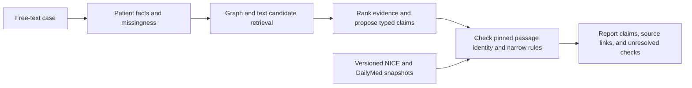

# Evidence-linked Graph-RAG for clinician review of differential and conditional treatment claims: architecture and exploratory evaluation

**Manuscript status:** Research methods and engineering feasibility draft, 13 October 2026. Author names, affiliations, contributions, funding, and competing-interest declarations must be completed by the actual contributors before submission. The software has not been clinically validated.

## Abstract

**Background:** A clinical decision support report can look well sourced even when its citations merely point to related text. We studied whether a retrieval-based prototype can expose the provenance and verification state of each proposed diagnosis, investigation, treatment option, and medication warning for clinician review. **Methods:** We implemented a local Graph-RAG pipeline that extracts facts from free text, retrieves graph and text candidates, proposes structured claims, and checks cited passages against versioned guideline and drug-label snapshots. The verification gate reserves `supported` for narrowly specified, rule-checked label warnings. We ran a six-case synthetic safety/boundary set, a 12-case four-condition synthetic diagnostic pilot, a frozen 36-vignette MedQA test-split exam pilot, a ten-query known-passage retrieval probe, and separate frozen safety and provenance challenges. **Results:** All 162 case–mode analyses completed. In the synthetic diagnosis-withheld pilot, exact matches to provisional author labels were 10/12, 9/12, and 10/12 for LLM only, text RAG, and graph plus text. In the MedQA exam subset, strict rank-1 answer-key agreement was 19/36, 12/36, and 14/36; the graph returned zero disease candidates. On the 26-passage retrieval probe, Hit@5 was 6/10, micro Recall@5 was 8/12, and full-context direct-answer relevance was 12/100 passages. In 108 developer-labeled amlodipine cases, a structured safety path found 72/72 expected warning types, while deterministic text extraction found 68/72 and missed four unknown-allergy warnings. All 26 valid provenance controls passed, and 132 constructed corruptions were rejected. Clinical claim support and safety-case labels were not independently adjudicated. **Conclusion:** The prototype demonstrates an inspectable claim and provenance workflow with a restricted adult-hypertension authoritative-source corpus. Exam-key agreement, synthetic fixtures, and known-passage retrieval do not establish patient diagnostic accuracy, prescribing safety, graph benefit, calibrated confidence, or patient benefit.

**Keywords:** clinical decision support; retrieval-augmented generation; knowledge graph; provenance; claim verification; medication safety; exam-vignette evaluation

## 1. Introduction

Clinician-facing decision support requires more than a plausible differential or a list of linked documents. A user must be able to distinguish an observation stated in the case, a retrieved association, a model proposal, and a claim whose source and patient conditions have actually been checked. Retrieval-augmented generation (RAG) connects generated text to external material, while biomedical knowledge graphs offer typed relations among diseases, drugs, and phenotypes [1,2]. Neither retrieval mechanism, by itself, proves that an individual recommendation is clinically appropriate.

This work addresses a narrower technical problem: how to preserve the source and verification state of each proposed clinical claim through a Graph-RAG pipeline. Free-text histories can omit drug doses, allergy status, pregnancy status, blood-pressure readings, or other conditions that change the interpretation of a guideline or label. A general web snippet or graph edge can also be mistaken for a current, jurisdiction-specific recommendation. We therefore keep candidate signals separate from versioned, locally pinned source passages and display unresolved checks rather than silently turning a citation into an endorsement.

We built a prototype for clinician review of ranked differential candidates, investigations, conditional treatment options, and medication warnings. The implemented contribution is an explicit claim object with evidence IDs, conditions, missing checks, and a conservative verification state; a source manifest and passage-identity check; and an evaluation harness that records cases, modes, citations, model-provider traces, and failures. The present source set covers selected adult-hypertension recommendations from NICE NG136 and one United States amlodipine label [3,4]. It is a deliberately limited test bed, not a universal clinical standard or a comprehensive medication knowledge base.

We report engineering feasibility on six safety/boundary fixtures, a separate four-condition diagnostic pilot with 12 synthetic cases, and a frozen 36-vignette MedQA exam subset. The study asks whether the code completes across three retrieval modes, preserves pinned citation identity, matches specified reference labels, emits expected narrow warning types where defined, and exposes failure modes. It cannot answer whether the system improves physician decisions or safely recommends medicines. Reporting guidance for *live* early-stage clinical evaluations, such as DECIDE-AI, is relevant to later studies but does not describe these offline experiments [5].

## 2. Related work and positioning

RAG combines generation with retrieval from an external corpus and was introduced for knowledge-intensive language tasks [1]. PrimeKG demonstrates the utility of integrated biomedical entities and relations for precision-medicine research [2]. Our pipeline uses graph relations to surface candidate diagnoses and conflicts, while text retrieval supplies textbook context and separately indexed guideline and label passages. The present work makes no claim to a new retrieval algorithm or a novel biomedical graph.

Clinical use introduces an additional distinction between *source provenance* and *claim support*. A passage may be authentic yet irrelevant to the patient's population, incomplete for a treatment decision, or from a different jurisdiction. The implementation responds by retaining document identity, version, section, passage text, and source link and by restricting automatic support to two narrow amlodipine-label warning rules. The architecture is thus best viewed as a traceable review interface and abstention mechanism, not an automated clinical guideline interpreter.

## 3. Methods

### 3.1. Scope and system architecture

The input is a free-text synthetic clinical case; the output is a structured report for clinician inspection. The current deployment uses a browser interface and a FastAPI `POST /analyze` endpoint. Neo4j stores a locally imported subset of biomedical graph rows; Qdrant stores a limited textbook excerpt and separate authoritative-source collections. Local HPO, MONDO, and DrugCentral files support term normalization and candidate associations. Optional Serper search can provide discovery leads. The detailed module and data-flow diagram is in [ARCHITECTURE_DIAGRAM.md](../ARCHITECTURE_DIAGRAM.md).

**Figure 1.** The source-verification boundary. Graph edges, textbook passages, DrugCentral associations, and web snippets may inform proposals. Only manifest-pinned guideline or label passages enter the citation-identity gate; an authentic passage still does not automatically establish semantic or patient-specific support.

### 3.2. Patient facts and candidate retrieval

The clarifier extracts symptoms, conditions, medications, allergies, and relevant missing information from the case. A fact-extraction pass anchors clinically important values to the original wording, and ontology linking maps selected terms to local HPO, MONDO, and drug-name resources. The resulting `PatientContext` preserves known, absent, and unknown states. This anchoring is necessary because a fabricated or misread patient fact can defeat later safety checks even when the cited label is authentic.

The retrieval orchestrator queries graph, textbook, authoritative-source, and optional discovery channels. It preserves the channels as different evidence classes rather than merging every result into one pool of “verified evidence.” Graph relations and DrugCentral targets are candidate signals; textbook hits offer context; Serper snippets are leads. The citable channel contains section-level `SourcePassage` objects from pinned publisher documents. Evidence ranking and conflict detection organize these inputs before model synthesis, but ranking is heuristic and does not measure clinical certainty.

### 3.3. Claim proposal and verification boundary

The fusion stage proposes ranked diagnoses and typed diagnosis, investigation, and conditional-treatment claims. A `ClinicalClaim` records the claim type, target, conditions, missing checks, supporting/conflicting/unverified evidence IDs, verification status, and a reason for unresolved status. New model claims start `unverified`. Source-ID normalization rejects invented or non-authoritative citation IDs; the report schema checks that referenced IDs resolve to passages included in the response.

The verifier reloads the local authoritative snapshots, checks their SHA-256 values and document versions against `sources/hypertension/manifest.json`, and compares each retrieved passage with the pinned text and metadata. It also checks limited source type, topic, and population constraints. Passing these checks establishes passage identity, not general semantic entailment. Diagnosis, investigation, and treatment proposals remain unverified where clinical meaning or patient applicability has not been independently established. A separate rule path can support an amlodipine-sensitivity warning and an amlodipine–simvastatin interaction warning when explicit patient facts and the exact relevant label passage are present. The label specifies known sensitivity as a contraindication and a simvastatin daily-dose limit with amlodipine [4]; the prototype does not infer an actual simvastatin dose when the case omits it.

The report exposes differential candidates, claims, medication-safety findings, citations, and verification gaps. A legacy `overall_confidence` field and retry heuristic remain in the API for compatibility; the percentage is not a calibrated diagnostic probability and is hidden by the current review interface. Unknown patient information is treated as a missing check or warning, not as evidence of safety.

### 3.4. Versioned source corpus

The source manifest pins selected sections of NICE guideline NG136 for adult hypertension in England, updated 26 February 2026, and a DailyMed amlodipine structured product label for the United States, effective 1 January 2026 [3,4]. The local parser produced 17 selected NICE passages and 9 label passages. Each source record includes publisher, document ID, version, date, jurisdiction, URL, section, local snapshot path, and SHA-256 hash. Passage IDs derive from document identity, version, section, span, and content hash. The raw documents are retained locally and excluded from Git; a changed publisher page requires an explicit manifest review and reindex rather than a silent replacement. Independent clinician review of source choice and scope is pending.

### 3.5. Synthetic evaluation design

The frozen `evaluation/cases.v1.json` contains six hand-authored cases: four known-hypertension cases testing amlodipine allergy, amlodipine–simvastatin co-medication, unknown allergy status, and no identified warning; one pregnancy case outside the adult-hypertension guideline's treatment scope; and one known gastroesophageal reflux disease case outside the pinned source domain. Every reference diagnosis is explicitly present in the input wording. The fixtures were kept outside the retrieval corpora, and the runner checks for verbatim overlap with pinned passages. They were not selected or adjudicated by clinicians.

We compared three configurations using the production analysis path and a retrieval substitution: `llm_only` removes retrieval; `text_rag` adds textbook vectors and pinned passages; `graph_text` adds graph candidates to the same text retrieval. DrugCentral and web discovery were disabled in all arms. The clarifier ran once per case and its output was reused across arms; arm order rotated by case. The run used temperature zero and no retries. The manifest records source and dataset hashes, prompt hashes, configured and selected model providers, and Git state. Provider fallback can change the synthesis model between arms, and the `openrouter/free` route does not identify a stable underlying model.

The engineering endpoints for this set were exact normalized alias match of the explicit reference diagnosis at rank 1 and within the first three ranks; citation identity matching of every emitted pinned-source ID to local metadata and text; presence of three predefined warning types; supported-label-warning presence for the two label rules; and the fraction of claims left `unverified`. We also recorded case-level errors and latency. These are descriptive counts over six fixtures, with no inferential statistics. Claim-support accuracy, unsupported-claim rate, and unsafe-treatment-option rate require two independent clinical reviewers and were not scored. A blinded packet and private mode index are generated for that future review.

A second, separately versioned [synthetic diagnostic pilot](../evaluation/cases.multidisease-pilot.v1.json) contains three adult presentations each for hypertension, chronic asthma, type 2 diabetes, and GORD/dyspepsia. Diagnosis names are withheld from case text. The author-intended labels were constructed with public NICE and WHO guidance as context [3,6–8], but were not independently clinician adjudicated. The application's pinned authoritative sources remained limited to selected hypertension and amlodipine passages. The pilot used the same three modes, zero retries, and once-per-case clarification, and saved provider/model traces. Its prespecified endpoint was strict normalized alias match at rank 1 and within the first three ranks, reported per condition with attempted/completed counts and descriptive Wilson 95% intervals. The pilot included no positive warning cases or independently labeled relevant passages; warning sensitivity and retrieval Hit@k/Recall@k therefore remain unavailable. Captured reports were replay-scored and the metrics matched byte for byte.

A third, separately selected pilot uses the local [MedQA USMLE test split](https://github.com/jind11/MedQA), an exam-question source rather than patient records [9]. Before inference, a checksum-locked adapter scanned 1,273 questions for an exact terminal “most likely diagnosis?” prompt, a keyed answer matching its option, a vignette of at least 100 characters, and absence of the literal answer in that vignette. This yielded 89 eligible questions (27 Step 1; 62 Step 2/3). A fixed SHA-256 ordering selected 12 and 24 respectively, producing 36 distinct keyed answers. The [committed selection manifest](../evaluation/medqa_selection.v1.json) preserves the source hash, seed, rules, quotas, and original zero-based row indices. Only the vignette before the final question was passed to the pipeline; answer choices, the question, and answer key were hidden from the model. The same three modes, zero retries, and once-per-case clarification were used. The endpoint is strict normalized exact answer agreement at rank 1 and within the first three diagnoses, with attempted/completed denominators. This is not multiple-choice accuracy or patient-case diagnostic accuracy. Synonyms can count as misses, and exposure of public MedQA test questions in provider training cannot be ruled out. MedQA provides no gold labels for claim support, unsafe treatment, warning detection, or passage relevance.

### 3.6. Pinned-source retrieval measures

The MedQA answer key cannot provide a relevance reference for this project's guideline and label passages. We therefore froze a [separate ten-query known-passage set](../evaluation/retrieval_probes.v1.json) before retrieval. Developer-authored queries target the full locally pinned corpus of 17 NICE NG136 recommendation passages and nine DailyMed amlodipine-label chunks. Each query assigns grade 2 to passages that directly answer it, grade 1 to related but insufficient passages, and grade 0 to unlisted passages. Thirteen listed facts each link to one or more directly answering passages. These judgments derive from the searched corpus, with no blinded or clinician review, and test source recovery rather than patient-case evidence selection. Textbook and graph retrieval have no comparable relevant-ID judgments in this study.

The production source retriever returns five guideline hits followed by five label hits, without global score merging. We saved the actual ordered source IDs, checked source-collection counts and pinned identities, and scored *k* = 1, 3, 5, 10. Binary Precision@k, Recall@k, Hit@k, and MRR@k use only grade-2 passages; graded nDCG@k uses gain `2^grade − 1` and a logarithmic rank discount. Recall is relative to all directly answering judgments **within these 26 passages**. Full-context relevance is directly answering retrieved passages divided by all retrieved passages; required-fact context recall is listed facts with any supporting passage retrieved divided by all listed facts. Query latency excludes model initialization. The saved IDs were replay-scored without Qdrant or embedding calls. Answer faithfulness, answer relevance/completeness, cost per query, and clinical task completion remain unavailable without independent generated-answer judgments, cost traces, or clinician outcomes.

### 3.7. Medication safety and provenance challenges

The [pre-run protocol](../evaluation/SAFETY_PROVENANCE_PROTOCOL.md) and [108-case synthetic set](../evaluation/med_safety_cases.v1.json) were committed before execution. Nine strata contain 12 cases each, including two positive amlodipine-label warning types, simultaneous warnings, missing or conflicting allergy histories, and hard negatives involving other allergies, stopped simvastatin, lookalike names, and clear histories. Expected warning types and support states were developer-authored before the test; clinician review is pending. Each case supplied a fixed proposed amlodipine option and all pinned label passages. One LLM-free path used intended structured facts; the other applied the production deterministic safety-fact extractor to the free text with empty model hints. Neither path is a complete `/analyze` run. Warning precision/recall, unexpected supported-warning decisions, unknown-allergy abstention, extracted fact matches, and treatment-conflict matches were scored with explicit denominators and descriptive Wilson intervals.

For provenance integrity, all 26 pinned passages were tested as valid cited controls, followed by five one-factor corruptions per passage: invented claim citation ID, wrong document version, changed passage, wrong source type, and forged retrieved ID. An incorrect expected SHA-256 was also tested for both source snapshots. A rejected citation had to count invalid, and a corrupted retrieved passage had to be excluded from trusted passages. General proposed claims remain `unverified` regardless of citation identity, so that status alone was not treated as successful tamper rejection. A [blinded clinician label-review packet](../evaluation/SAFETY_LABEL_REVIEW.md) was prepared but has not been rated.

## 4. Results

All six cases completed in each of the three modes, giving 18 completed analyses and no run failures. Table 1 reports the aggregate counters from the saved 7 October 2026 run as rescored without new model calls. The denominators are small and should be read as fixture counts, not estimates of population performance.

| Engineering measure | LLM only | Text RAG | Graph + text |
| --- | ---: | ---: | ---: |
| Completed cases | 6/6 | 6/6 | 6/6 |
| Explicit diagnosis alias at rank 1 | 1/6 | 4/6 | 5/6 |
| Explicit diagnosis alias within top 3 | 1/6 | 4/6 | 6/6 |
| Pinned citation identity matched | No IDs emitted | 13/13 | 17/17 |
| Expected warning type present | 2/3 | 2/3 | 2/3 |
| Label warning with `supported` status | 0/2 | 1/2 | 1/2 |
| Claims marked `unverified` | 14/14 | 11/12 | 17/18 |
| Clinician-adjudicated support or safety | Unavailable | Unavailable | Unavailable |

**Table 1.** Engineering results on six hand-authored synthetic cases. An exact citation match verifies stored passage identity only. The `supported` warning counter concerns the two narrow label rules, not treatment efficacy or safety clearance.

The retrieval-mode ranking counts are not a controlled estimate of the graph's incremental benefit. Synthesis providers matched across modes for three cases, differed for two, and were unknown for one. In addition, the reference diagnosis was already written into every case, so alias matching largely tests recognition and output selection. For the amlodipine-allergy case, graph plus text placed “amlodipine hypersensitivity” first and hypertension second; the top-1 alias metric recorded a miss even though the safety issue appeared. This illustrates the metric's sensitivity to ranking and its inability to grade a clinically meaningful differential.

The unknown-allergy fixture exposed a concrete extraction failure. The input stated, “His allergy history was not supplied,” yet the extraction path treated “his” as an allergy mention; `allergy_status_unconfirmed` was therefore missed in all three modes. This failure occurs upstream of retrieval and shows why correct source linking cannot compensate for an incorrect patient context. The warning-type count was 2/3 in every arm. No false-positive label-warning case was counted among the three warning-negative fixtures, but that small denominator cannot establish specificity.

The 13/13 and 17/17 citation-identity results show that emitted IDs resolved to pinned passage text and metadata in those runs. They do not show that the passages entail the generated claims, that all relevant contraindications were retrieved, or that a proposed option is safe for an individual. Most claims remained `unverified`. No independent reviewer labels were available, so clinically adjudicated claim support and unsafe-option measures are explicitly unavailable.

### Four-condition diagnostic pilot

The separate 12 October 2026 pilot completed 36/36 case–mode analyses. Table 2 shows strict rank-1 matches to provisional author-intended labels, three cases per condition. Rank-3 counts were identical in every row because the correct exact alias did not appear later when rank 1 missed. These are small synthetic fixture counts, **not** estimates of clinical diagnostic accuracy.

| Intended condition | LLM only | Text RAG | Graph + text |
| --- | ---: | ---: | ---: |
| Hypertension | 1/3 | 2/3 | 3/3 |
| Chronic asthma | 3/3 | 2/3 | 2/3 |
| Type 2 diabetes | 3/3 | 3/3 | 2/3 |
| GORD-like presentation | 3/3 | 2/3 | 3/3 |
| **All cases** | **10/12** | **9/12** | **10/12** |

**Table 2.** Exact author-label matches on a four-condition diagnosis-withheld synthetic pilot. Descriptive Wilson 95% intervals for the totals are 0.55–0.95 (10/12) and 0.47–0.91 (9/12); for each three-case condition, 3/3 spans 0.44–1.00. The [pilot result snapshot](MULTIDISEASE_PILOT_RESULTS.json) records denominators, all rank-1 strings, provider selections, hashes, and graph counts.

Several strict-match misses reflect wording: “Stage 2 Hypertension” did not match the alias “hypertension,” while “Reversible airflow obstruction” was not scored as “asthma.” One text-RAG GORD report and one graph-plus-text diabetes report had no ranked diagnoses despite completing. No clinician evaluated whether the outputs represented acceptable differentials or whether the author-intended labels were sufficient reference standards. Elevated HbA1c alone also does not establish a diabetes *subtype*, so the intended type 2 labels remain provisional.

The graph arm retrieved **zero disease candidates for all 12 pilot cases**. The local Neo4j audit found 14,467 nodes and 649,815 edges, but zero phenotype-type relations used by the current disease query. The graph mode supplied no observed graph disease signal. Synthesis providers matched across the three modes for 10 cases and differed for two after fallback (OpenRouter in one text-RAG arm and Cohere in one graph-plus-text arm). The difference between text RAG and graph plus text cannot be attributed to graph retrieval.

The text and graph-plus-text arms each returned 120 authoritative *candidate* passages across the 12 cases, all from the existing hypertension/amlodipine corpus. Citation identity matched 30/30 and 26/26 emitted uses, respectively. All pilot claims remained `unverified` (41/41, 34/34, and 22/22 across the three arms). Citation relevance, patient-specific claim support, treatment safety, warning sensitivity, and retrieval Hit@k/Recall@k were not established for this synthetic pilot. The 60 automated code tests passed after the retrieval-probe additions; they are engineering checks, not clinical validation.

### MedQA test-split exam-vignette pilot

The frozen 36-vignette subset completed **108/108** case–mode analyses on 13 October 2026. Table 3 reports strict normalized agreement with the single keyed exam diagnosis, scored without giving the model the answer options or final question. The saved outputs were rescored without provider calls; the replayed metric file was byte-identical. These are open-ended exam-vignette answer matches, **not** multiple-choice scores or patient diagnostic accuracy.

| Exam measure | LLM only | Text RAG | Graph + text |
| --- | ---: | ---: | ---: |
| Completed cases | 36/36 | 36/36 | 36/36 |
| Step 1 exact rank 1 | 5/12 | 3/12 | 2/12 |
| Step 2/3 exact rank 1 | 14/24 | 9/24 | 12/24 |
| **Overall exact rank 1** | **19/36** | **12/36** | **14/36** |
| Exact answer within top 3 | 19/36 | 13/36 | 14/36 |
| Completed reports with no ranked diagnosis | 1/36 | 8/36 | 13/36 |
| Pinned citation identity matched | No IDs emitted | 22/22 | 10/10 |
| Claims left `unverified` | 160/160 | 94/94 | 78/78 |

**Table 3.** Diagnosis-prompt cases selected by a fixed rule and seed before inference. Descriptive Wilson 95% intervals for overall rank-1 agreement are 0.37–0.68, 0.20–0.50, and 0.25–0.55, respectively. These intervals describe the selected exam subset and do not estimate clinical performance. The [selection manifest](../evaluation/medqa_selection.v1.json) and [aggregate snapshot](MEDQA_EXAM_PILOT_RESULTS.json) preserve source indices, rules, per-step counts, provider counts, hashes, and denominators without distributing the exam questions or answers.

The LLM-only arm had the highest observed exact-answer agreement. The retrieval arms returned more empty ranked lists even though their API calls completed. Graph plus text returned **zero graph disease candidates** in all 36 cases, so there was no graph disease signal to evaluate. Each retrieval arm returned 360 pinned authoritative candidate passages from the restricted hypertension/amlodipine corpus. Citation identity checks passed for emitted uses, but neither passage relevance nor claim support was independently judged. Synthesis providers matched across the three arms in 28 cases and differed in eight because Gemini Flash Lite was rate limited on some calls and fallback selected Gemini Flash. Provider differences, output variability, and the lack of graph candidates prevent causal attribution of mode differences to retrieval. Synonyms can count as exact-match misses; public MedQA material may have appeared in provider training data. MedQA contains no gold labels for medication warnings, treatment safety, claim support, or relevant passage ranks.

### Known-passage retrieval probe

All **10/10** source-section queries completed on the 26-passage pinned corpus. The live ranked source IDs were replay-scored, producing a byte-identical metric file. Table 4 reports binary metrics against 12 developer-judged directly answering passages and graded nDCG using related-but-insufficient passages as grade 1.

| Retrieval measure | @1 | @3 | @5 | @10 |
| --- | ---: | ---: | ---: | ---: |
| Precision@k | 6/10 (0.600) | 7/30 (0.233) | 8/50 (0.160) | 12/100 (0.120) |
| Micro Recall@k | 6/12 (0.500) | 7/12 (0.583) | 8/12 (0.667) | 12/12 (1.000) |
| Hit Rate@k | 6/10 (0.600) | 6/10 (0.600) | 6/10 (0.600) | 10/10 (1.000) |
| MRR@k | 0.600 | 0.600 | 0.600 | 0.667 |
| Mean nDCG@k | 0.600 | 0.495 | 0.529 | 0.670 |

**Table 4.** Frozen developer-judged known-passage retrieval. Recall is bounded to all directly answering labels in the 26-passage corpus, not all medical evidence. Full-context relevance was **12/100** directly answering passages; required-fact context recall was **13/13** developer-listed facts. The [retrieval snapshot](RETRIEVAL_PROBE_RESULTS.json) stores exact per-query denominators, hashes, latency, and definitions without passage text.

All six guideline-focused probes had a direct-answer passage at rank 1, whereas all four label-focused probes first found one at rank 6. This follows the application's fixed assembly order of five guideline passages before five label passages. Median retrieval-only query latency was 41.5 ms (p95 126.4 ms), excluding model initialization and answer generation. The high full-context fact coverage is expected to be optimistic because the questions were authored from the searched passages. Precision@10 of 0.12 shows that most returned chunks were not labeled directly answer bearing for these narrow queries. No source-relevance metric is asserted for the MedQA exam questions, textbook chunks, or graph paths; those channels lack independent relevant-document judgments.

### Medication safety and provenance challenges

Both paths completed all **108** synthetic medication cases. The structured-fact path matched all 72 expected warning-type events, while the deterministic text-extraction path matched **68/72**; all four misses were unknown-allergy cases. No unexpected warning was emitted in either path. Table 5 gives the prespecified safety counters with descriptive Wilson 95% intervals.

| Measure | Intended structured facts | Deterministic text extraction |
| --- | ---: | ---: |
| Warning precision | 72/72 (1.000; 0.949–1.000) | 68/68 (1.000; 0.947–1.000) |
| Warning recall | 72/72 (1.000; 0.949–1.000) | 68/72 (0.944; 0.866–0.978) |
| Unexpected `supported` warning decisions | 0/168 (0.000; 0–0.022) | 0/168 (0.000; 0–0.022) |
| Unknown/conflicting-allergy abstention | 24/24 (1.000; 0.862–1.000) | 20/24 (0.833; 0.642–0.933) |
| Intended allergy status recovered | 108/108 | 104/108 |

**Table 5.** Developer-labeled, source-derived amlodipine challenge. The 168 negative support opportunities are case × label-warning-type decisions and are correlated within cases; intervals are descriptive only. Fixed proposals and supplied passages isolate the safety logic, so these numbers are not end-to-end prescribing-safety estimates. The [safety snapshot](MEDICATION_SAFETY_TEST_RESULTS.json) records each stratum, all four failure IDs, case/source hashes, and clean run Git SHA.

The four misses occurred on “No allergy history was recorded.” The extractor interpreted `No allergy` as an allergy mention, assigned `allergies_reported`, and omitted the `allergy_status_unconfirmed` warning. This finding extends the earlier six-case missing-allergy failure: the safety gate performs as designed on intended structured facts but can be bypassed by incorrect upstream fact extraction. The benchmark labels have not been independently clinician reviewed.

All **26/26** valid source controls were accepted, and all **132/132** constructed provenance corruptions were rejected: 26/26 per one-factor passage/citation mutation type and 2/2 wrong source-snapshot hashes. The [tamper snapshot](PROVENANCE_TAMPER_RESULTS.json) records exact counts and provenance. These are deterministic test-case results, not a statistical estimate of clinical citation truth. An authentic source can still be irrelevant or inapplicable to a claim.

## 5. Discussion

The strongest observed result is traceability at the boundary between generated claims and versioned source passages. An operator can inspect which document, version, section, and passage was associated with a claim and see when the system abstained. The code also distinguishes graph and textbook candidate signals from pinned citations. These are inspectability properties of the software; they should not be read as evidence that its clinical advice is correct.

The design has several clinical and technical limits. The source corpus is restricted to one guideline topic and one repackaged amlodipine label, with different jurisdictions and no independent clinician source review. The local graph importer defaults to only the first 50,000 CSV rows, and the textbook importer indexes only the first 150,000 characters of one file. Both diagnostic pilots returned zero graph disease candidates, so they cannot test an incremental graph benefit. The first two case datasets are small and hand-authored; their labels have no independent clinical adjudication. The MedQA dataset uses exam questions, not patient records; public test exposure in model training cannot be excluded. The separate retrieval probes were written from the same narrow source corpus they search, and their relevance and fact judgments have no independent clinical review. The 108 safety challenges likewise derive from the implemented amlodipine rule scope and have developer-authored labels; their fixed proposal and supplied label passages omit LLM synthesis and live source retrieval. The provenance challenge measures identity, not semantic support. Textbook and graph retrieval remain unscored. None of the case sets has an independent differential, negative/mimic reference set, or real-case sampling frame. Fact extraction can fail on ordinary negation or missingness, as the allergy example shows. Provider fallback changes the model used in some arms, and `openrouter/free` prevents exact model-version recovery. The prototype lacks authentication, audit logging, patient-data governance, a prospective clinical workflow, and outcome measures. Accordingly, the study cannot establish safe prescribing, diagnostic superiority, graph benefit, or clinical utility.

A future evaluation would first have clinicians review the source set, case labels, and intended use; then use a larger, independently selected and blinded case set with controlled model identity and frozen retrieval indexes. Two reviewers would judge each claim against its cited section, date, population, conditions, and case facts; disagreements would be reconciled before claim-support and unsafe-option metrics are reported. Error analysis should include missing information, out-of-domain cases, contraindications beyond amlodipine, and failure to abstain. Only after those offline steps would a governed live clinician study be appropriate; DECIDE-AI offers reporting guidance for that later stage [5].

## 6. Conclusion

This prototype implements a claim-level provenance and abstention workflow for a narrow clinician-review setting. Its six-case set completed 18 analyses, the four-condition synthetic pilot completed 36, and the MedQA exam-vignette pilot completed 108. Strict rank-1 agreement with the MedQA key was 19/36, 12/36, and 14/36 across the three modes; the retrieval arms produced more empty differentials. A separate known-passage probe had Hit@5 of 6/10 and context relevance of 12/100; all four label-focused queries first found the directly answering passage at rank 6 under the current collection order. In the frozen safety challenge, structured facts yielded 72/72 expected warnings and deterministic free-text extraction 68/72, exposing four additional missing-history errors. All 26 valid provenance controls passed and all 132 constructed corruptions were rejected. Emitted pinned citation IDs matched local source passages in retrieval arms, but clinical support was not adjudicated. The diagnostic runs also returned zero graph disease candidates and had provider-confounded comparisons. Patient-level diagnostic correctness, treatment safety, and graph benefit remain open questions requiring independent expert review and broader controlled evaluation.

## Reproducibility and declarations

**Code and artifacts.** Code, [six-case fixtures](../evaluation/cases.v1.json), [four-condition pilot cases](../evaluation/cases.multidisease-pilot.v1.json), [MedQA selection manifest](../evaluation/medqa_selection.v1.json), [known-passage retrieval probes](../evaluation/retrieval_probes.v1.json), [frozen safety cases](../evaluation/med_safety_cases.v1.json), evaluation definitions, source manifest, and detailed architecture are in this repository: [CDSS_SDC2](https://github.com/Arnavmangarapu/CDSS_SDC2). Commands and metric definitions are in [evaluation/README.md](../evaluation/README.md). The six-case [aggregate snapshot](RESULTS_SNAPSHOT.json), [synthetic pilot snapshot](MULTIDISEASE_PILOT_RESULTS.json), [MedQA exam-pilot snapshot](MEDQA_EXAM_PILOT_RESULTS.json), [retrieval snapshot](RETRIEVAL_PROBE_RESULTS.json), [safety snapshot](MEDICATION_SAFETY_TEST_RESULTS.json), and [provenance snapshot](PROVENANCE_TAMPER_RESULTS.json) preserve reported counters and provenance identifiers. Generated full report/retrieval JSONL files, private review indices, MedQA question text and answer keys, external datasets, database volumes, API keys, and publisher source snapshots are excluded from Git. Exact reruns need matching local data, source snapshots, provider availability, and model versions; the `openrouter/free` underlying model cannot be reconstructed from its route name.

**Human participants and ethics.** This report uses hand-authored synthetic fixtures and public medical-exam vignettes; it reports no patient or clinician-participant study. No determination of ethics exemption by an institution is asserted.

**Clinical responsibility.** The software is a research prototype for clinician inspection and has not been validated for care decisions. No author or manuscript statement should imply that a valid citation automatically makes a diagnosis or medication option safe.

**Authorship, funding, and interests.** The actual contributors must supply authorship and affiliation details and make their own funding and competing-interest declarations before submission; none are inferred here.

## References

1. Lewis P, Perez E, Piktus A, et al. [Retrieval-Augmented Generation for Knowledge-Intensive NLP Tasks](https://arxiv.org/abs/2005.11401). *Advances in Neural Information Processing Systems*. 2020;33.
2. Chandak P, Huang K, Zitnik M. [Building a knowledge graph to enable precision medicine](https://doi.org/10.1038/s41597-023-01960-3). *Scientific Data*. 2023;10:67.
3. National Institute for Health and Care Excellence. [Hypertension in adults: diagnosis and management, NG136 recommendations](https://www.nice.org.uk/guidance/ng136/chapter/Recommendations). Current project's pinned snapshot updated 26 February 2026; accessed for this manuscript 11 October 2026.
4. National Library of Medicine, DailyMed. [Amlodipine besylate tablets, structured product label, set ID 0c5784b9-5542-144f-e063-6394a90a7ebc](https://dailymed.nlm.nih.gov/dailymed/lookup.cfm?setid=0c5784b9-5542-144f-e063-6394a90a7ebc). Current project's pinned version 2, January 2026.
5. Vasey B, Nagendran M, Campbell B, et al. [Reporting guideline for the early-stage clinical evaluation of decision support systems driven by artificial intelligence: DECIDE-AI](https://doi.org/10.1038/s41591-022-01772-9). *Nature Medicine*. 2022;28:924–933.
6. British Thoracic Society, National Institute for Health and Care Excellence, Scottish Intercollegiate Guidelines Network. [Asthma: diagnosis, monitoring and chronic asthma management, NG245](https://www.nice.org.uk/guidance/ng245/chapter/Recommendations). Pilot case-design context only; not pinned for the application.
7. World Health Organization. [Use of glycated haemoglobin (HbA1c) in diagnosis of diabetes mellitus](https://www.who.int/publications/i/item/use-of-glycated-haemoglobin-%28-hba1c%29-in-diagnosis-of-diabetes-mellitus). Pilot case-design context only; not pinned for the application.
8. National Institute for Health and Care Excellence. [Gastro-oesophageal reflux disease and dyspepsia in adults: investigation and management, CG184](https://www.nice.org.uk/guidance/cg184/chapter/Recommendations). Pilot case-design context only; not pinned for the application.
9. Jin D, Pan E, Oufattole N, et al. [What Disease does this Patient Have? A Large-scale Open Domain Question Answering Dataset from Medical Exams](https://arxiv.org/abs/2009.13081). 2020. Source of the MedQA exam-vignette test split used for the third pilot.

## Draft self-review and claim–evidence map

This appendix follows the [research-paper-writing skill](https://github.com/Master-cai/Research-Paper-Writing-Skills), adapted from [Peng Sida's public notes](https://github.com/pengsida/learning_research). It is a review aid for this draft, not evidence of clinical quality.

| Review dimension | Current assessment | Required evidence before a clinical-effectiveness claim |
| --- | --- | --- |
| Contribution | Implemented claim/provenance boundary and reproducible synthetic harness; novelty relative to comparable CDSS remains unproven | Systematic comparison with related clinical evidence-grounding systems |
| Writing clarity | Input, modules, trust boundary, corpus, denominators, and failure cases are defined | Target-journal formatting and contributor review |
| Experimental strength | Six safety fixtures, a 12-case four-condition synthetic pilot, 36 selected MedQA exam vignettes, and ten developer-judged source probes; graph retrieval supplied zero disease candidates, and provider identity differed across modes in eight exam cases | Larger clinician-adjudicated patient cases, independently judged retrieval relevance, working graph coverage, and stable models |
| Evaluation completeness | Citation identity and narrow warning counters available; no clinician adjudication | Two independent reviewer labels for claim support and option safety, then prospective workflow study |
| Method soundness | Source pinning and abstention are explicit; extraction error and narrow scope remain | Fix and retest missingness extraction; broaden reviewed source/rule coverage; assess deployment controls |

| Major statement in this manuscript | Evidence | Status |
| --- | --- | --- |
| The software tracks typed claims, source IDs, and unresolved checks | `backend/schemas/report.py`, `backend/services/claim_verifier.py`, architecture documentation | Implemented property |
| The synthetic run completed 18 analyses | Saved aggregate run manifest and counters in `RESULTS_SNAPSHOT.json` | Supported as an engineering observation |
| Emitted citation IDs matched pinned passages in text and graph-plus-text arms | 13/13 and 17/17 citation-identity counters | Supported for this run; not semantic entailment |
| Graph retrieval improves clinical diagnosis | No controlled, clinician-labeled comparison; provider fallback confounded arms | **Not claimed** |
| The system safely recommends medicines or improves outcomes | No clinician adjudication or prospective data | **Not claimed** |

**Section outline check.** The introduction defines the claim-provenance problem and scope; related work locates RAG and graph retrieval; methods state the pipeline and source boundary; results give denominators and failures; discussion separates inspectability from clinical effectiveness; the conclusion repeats only observed findings. Each section's opening paragraph states its role, and the terms *candidate*, *pinned citation*, *supported warning*, and *unverified claim* retain distinct meanings throughout.
