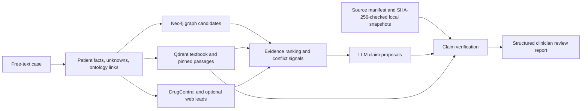
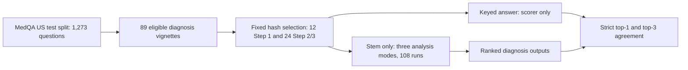

# Title

**Evidence-linked Graph-RAG for clinician review of differential diagnoses and conditional treatment claims: system design and exploratory evaluation**

*Working manuscript draft, 13 October 2026. The headings follow the template supplied by the project owner. Formatting, word limits, declarations, and article type still require checking against the selected journal's current author instructions. This draft reports engineering feasibility and exam-vignette answer agreement, not clinical validation.*

# Author names and affiliations

**Author 1:** [Full legal name], [Department], [Institution], [City], [Country].

**Author 2:** [Full legal name], [Department], [Institution], [City], [Country], if applicable.

**Corresponding author:** [Name and institutional email].
**ORCID identifiers and author contributions:** [Supply for each actual contributor before submission].

These fields are intentionally open. Repository ownership or Git commits do not establish manuscript authorship or affiliation.

# Abstract

Clinical decision support generated with retrieval-augmented language models can present plausible claims with citations whose clinical relevance has not been established. We developed an evidence-linked Graph-RAG prototype that separates candidate evidence from versioned guideline and drug-label passages and exposes the verification status of individual diagnosis, investigation, treatment, and medication-warning claims. A free-text case is converted into structured patient facts and missingness; graph and text retrieval generate candidates; a language model proposes claims; and a separate gate checks citation identity against SHA-256-pinned local source snapshots and applies two narrow amlodipine-label warning rules. We evaluated six hand-authored safety/boundary fixtures, a 12-case four-condition synthetic diagnostic pilot, a frozen 36-vignette subset of the MedQA test split, a ten-query known-passage retrieval probe, and separate frozen medication-safety and provenance challenges. All 162 case–mode analyses completed. Exact rank-1 matches in the synthetic diagnosis-withheld pilot were 10/12, 9/12, and 10/12 across language-model-only, text-RAG, and graph-plus-text modes; in the MedQA exam subset, strict agreement with the keyed diagnosis was 19/36, 12/36, and 14/36. The graph arm retrieved zero disease candidates in both diagnostic pilots. On the 26-passage pinned-source probe, Hit@5 was 6/10, micro Recall@5 was 8/12, and full-context direct-answer relevance was 12/100 passages. In 108 developer-labeled synthetic amlodipine cases, the structured safety path found 72/72 expected warning events; deterministic text extraction found 68/72 and missed four unknown-allergy warnings. All 26 valid provenance controls passed, and all 132 constructed tamper checks were rejected. The safety labels and retrieval judgments were developer-authored, and clinical claim support was not adjudicated. The work demonstrates a traceable claim-review workflow within a limited adult-hypertension *authoritative-source* domain. It does not establish patient diagnostic accuracy, safe prescribing, a graph-retrieval benefit, calibrated probabilities, or patient benefit.

# Keywords

Clinical decision support; retrieval-augmented generation; biomedical knowledge graph; claim-level provenance; source verification; medication safety; exam-vignette evaluation.

# 1. Introduction

Clinical decision support systems can help organize case information and surface relevant knowledge for a clinician to examine. For a system that produces a differential diagnosis or a treatment option, the central requirement is that the reviewer can tell what was stated by the patient, what was retrieved, what was generated, and what remains unverified. A citation alone cannot answer whether a source applies to a particular patient or jurisdiction. This distinction matters especially for medication choices, where allergy status, current medicines, dose, pregnancy, and other missing facts can change the interpretation of a guideline or label.

Retrieval-augmented generation (RAG) combines a language model with external documents, while biomedical knowledge graphs encode relations among diseases, phenotypes, and drugs [1,2]. These methods can make candidate generation more informed, but the retrieved text or relation still has to be checked for identity, scope, and clinical meaning. A graph edge is not a prescription rule; a search snippet is not a guideline; and an authentic passage may support a general statement while being insufficient for a patient-specific recommendation. We therefore treat the movement from retrieved evidence to a clinical claim as a distinct system boundary.

The objective of this project is to implement a **clinician-facing, evidence-linked review prototype** that makes that boundary visible. The input is one free-text case; the output is a structured report with ranked differential candidates, possible investigations, conditional treatment considerations, medication warnings, source passages, and unresolved checks. The model may propose claims, but a separate verifier decides whether the cited passage matches a pinned source snapshot. General generated claims remain `unverified`; only narrowly defined amlodipine-label warnings can become `supported` when explicit patient facts and the exact label passage are present. The system is not intended to make an autonomous diagnosis or prescribe medicine.

The main technical contribution is an implemented claim-provenance contract rather than a new neural-network architecture. `ClinicalClaim` objects carry type, text, conditions, missing checks, evidence IDs, status, and an unverified reason. A versioned source manifest anchors the citable corpus, and a verification gate separates authentic passage identity from semantic or patient-specific support. A third contribution is a reproducible evaluation harness that records three retrieval modes, denominators, source and prompt hashes, provider traces, case-level errors, and a blinded packet for later clinician review. The claim that these features improve clinical decisions remains untested.

This paper reports three exploratory case-analysis evaluations: the original six-case safety/boundary set with explicit diagnoses, a 12-case synthetic pilot across four author-intended conditions with diagnosis names withheld, and a separately selected MedQA test-split exam-vignette pilot. It also reports separate source-retrieval, medication-rule, and provenance-integrity engineering probes. None supplies a representative patient sampling frame or clinician-adjudicated clinical reference standard; the reported counts are not clinical diagnostic-accuracy or safety estimates. The rest of the paper positions the design, describes the pipeline and frozen cases, reports the recorded results, and identifies the evidence required for later clinical evaluation.

# 2. Related Work / Literature Review

## 2.1. Retrieval-augmented generation and biomedical graph retrieval

Lewis and colleagues introduced RAG as a way to combine parametric generation with retrieved nonparametric memory for knowledge-intensive language tasks [1]. That result motivates retrieval as a source of context, but it does not imply that a retrieved passage clinically entails a generated answer. The present project uses retrieval for candidate generation and keeps a distinct verification stage; it does not claim to improve the underlying RAG algorithm.

Biomedical knowledge graphs connect heterogeneous entities and can reveal paths that are less obvious in a flat text search. PrimeKG is an example of an integrated graph for precision-medicine research [2]. In this prototype, graph relations stored in Neo4j provide possible disease and drug signals for the report. They are never sufficient by themselves to mark a treatment claim `supported`. This separation is central to the system's claim hierarchy: graph relations and textbook hits are *candidate context*, while versioned publisher passages are *citable sources* whose meaning still needs review.

## 2.2. Clinical terminology and evidence sources

The pipeline uses local Human Phenotype Ontology and Mondo files to normalize selected phenotypes and disease terms [6,7]. DrugCentral files contribute drug-name and target associations [8]. These resources help retrieval find related concepts, but a successful mapping is not a validated patient observation. The graph importer expects a PrimeKG-shaped CSV; the text importer reads a limited excerpt of one MedQA textbook file [2,9]. These data choices describe the current implementation, not a comprehensive clinical knowledge base.

For treatment and medicine-related citations, the current pinned corpus is deliberately smaller: selected recommendations from NICE NG136 on adult hypertension and one DailyMed structured product label for amlodipine [3,4]. These sources have different publishers and jurisdictions. The NICE document is a guideline for England; DailyMed hosts a United States drug label from a named labeler. Neither should be described as a universal “WHO/NCBI standard.” Their identity, date, section, population, and conditions must be carried with any proposed claim.

## 2.3. Evaluation and reporting context

The DECIDE-AI reporting guideline addresses *early-stage live clinical evaluation* of AI-based decision support [5]. Its emphasis on intended use, users, workflow, and safety is relevant to future work, but this study has no clinicians or patients in a live setting. We therefore report it as an offline engineering study with synthetic fixtures and explicit unavailable metrics. We do not treat a literature link, model self-rating, or citation count as a substitute for independent clinical adjudication.

# 3. Methodology / Proposed Method

## 3.1. Task definition and trust boundary

Let `x` be the free-text case, `c` the extracted patient context, `G` the retrieved graph candidates, `T` the textbook and pinned-source passages, and `R` the final report. The application first derives `c` from `x`; retrieval uses `c` to obtain `G` and `T`; a fusion model proposes a set of claims `C`; and a separate verification stage checks each claim's cited source IDs and any implemented safety rule. The result is `R = report(c, G, T, verify(C, T))`. This notation describes the implemented execution order, not a learned or calibrated clinical inference model. In particular, `verify` does not infer general textual entailment.

**Figure 1.** Runtime pipeline and trust boundary. Graph, textbook, DrugCentral, and web results can inform proposals. Only manifest-pinned guideline or label passages are eligible for citation-identity checks. The complete system, ingestion, and evaluation diagrams are in [ARCHITECTURE_DIAGRAM.md](../ARCHITECTURE_DIAGRAM.md).

## 3.2. Patient-context extraction

`ClinicalClarifier` parses the case into age, sex, symptoms, known conditions, current medicines, allergy statements, and missing information. A fact-extraction pass checks important statements against the original case text, while `OntologyParser` and `EntityLinker` normalize selected terms using local HPO, Mondo, and drug-name resources. `PatientContext` carries explicit `known`, `unknown`, or `conflicting` states for safety-critical fields such as allergy and medication list. The later safety rules use only explicitly extracted medication and allergy statements. This design aims to prevent an unstated dose or missing allergy history from being treated as a reassuring negative.

Extraction still remains fallible. The recorded unknown-allergy case shows that the phrase “His allergy history was not supplied” was misinterpreted by the extraction path, causing the expected missingness warning to disappear. This failure is not repaired by better downstream retrieval. Accordingly, the report preserves missing checks and is intended for clinician verification of the patient context itself.

## 3.3. Multi-source candidate retrieval and ranking

`RetrievalOrchestrator` queries a Neo4j biomedical graph, Qdrant textbook vectors, and separate Qdrant collections for pinned NICE and DailyMed passages. The normal application path can also use local DrugCentral associations and optional Serper discovery. `OrchestratorResult` retains these channels separately. `EvidenceRanker` orders candidates heuristically, and `ConflictDetector` flags possible graph contraindications or interactions as `unverified` leads. No heuristic evidence rank is interpreted as a diagnostic probability or an authorization to recommend treatment.

The local deployment matters to interpretation. `populate_neo4j.py` defaults to the first 50,000 rows of `datasets/kg.csv`, and `populate_qdrant.py` indexes only the first 150,000 characters of one MedQA English textbook file. The full graph and textbook corpora are not in the public repository. A null or sparse result can reflect local data coverage or a service outage as well as clinical irrelevance. Optional web snippets and DrugCentral target relations cannot become verified citations in the current claim gate.

## 3.4. Claim proposal, schema, and report assembly

`ClinicalFusion` proposes ranked diagnoses and typed diagnosis, investigation, and conditional-treatment claims from the patient context and retrieval results. `claim_synthesis.py` normalizes evidence IDs and rejects invented or non-authoritative citation IDs. Each new model-generated claim begins with `status=unverified`. A claim stores its text, target condition, prerequisites, missing checks, source IDs separated into supporting/conflicting/unverified buckets, and a reason when not verified. The `ClinicalReport` schema rejects duplicate claim IDs, unresolved included citation IDs, and mismatched claim-group references.

`ReportGenerator` then groups claims under differential entries and medication safety, includes the exact source passages and verification failures, and renders a case summary and limitations. The API still contains legacy `ranked_diagnoses` and `overall_confidence` fields. The latter is a retry heuristic, **not** a calibrated probability; the current browser review hides it. In the normal request path, an adaptive retry can run up to two additional analyses, while preserving the original case text as the extraction anchor. The evaluation disabled retries to keep comparisons bounded.

## 3.5. Pinned-source and safety verification

`sources/hypertension/manifest.json` records document IDs, version dates, URLs, sections, jurisdictions, local snapshot paths, and SHA-256 hashes. The current manifest pins NICE NG136 recommendations updated 26 February 2026 and one amlodipine SPL label effective January 2026 [3,4]. The ingestion parser yields 17 selected NICE passages and 9 label passages in the current local snapshot. A passage ID incorporates document identity, version, section, span, and text hash. Fetching or verifying a changed snapshot fails until a human reviews the new document and updates the manifest.

`ClaimVerifier` reloads the pinned snapshots, checks their bytes and version, and accepts a retrieved `SourcePassage` as trusted only when its ID, full metadata, and text equal the locally reconstructed passage. It rejects missing or mismatched citations and some obvious source/claim-scope mismatches, including use of a treatment section to establish a diagnosis or use of the adult guideline for a pregnant treatment case. Even after an exact identity match, it leaves general diagnosis, investigation, and treatment claims `unverified`, because it does not perform a validated patient-specific entailment test.

`ConflictDetector.detect_medication_safety` applies two narrow rules to explicitly stated amlodipine exposure or proposals. First, a reported amlodipine allergy can produce a source-backed warning and conflict with an amlodipine option if the label's contraindication passage is present. Second, current amlodipine plus simvastatin can produce a source-backed interaction-review warning if the relevant label passage is present; the system does not invent the patient's simvastatin dose. The DailyMed label describes known amlodipine sensitivity as a contraindication and a simvastatin daily-dose limit with amlodipine [4]. Unknown allergy or medication-list states generate unresolved warnings rather than safety clearance. These rules cover only the named drug and label sections; they do not constitute a complete drug-interaction engine.

## 3.6. Provider fallback and data boundaries

`LLMFallback` tries configured providers in order when one is unavailable; the selected provider and model are recorded per analysis when trace information is available. This improves engineering continuity but makes comparisons difficult when different arms use different synthesis models. The `openrouter/free` route can change its underlying model, so even a matched route name is not enough to recover the exact model version. Prompts, source hashes, and configured model IDs are recorded in the evaluation manifest; output reproducibility remains conditional on provider availability.

The prototype runs locally but may send case text to configured external language-model services and selected terms to optional web search. It has no deployment-grade authentication, audit logging, privacy governance, or clinical sign-off process. Only synthetic or appropriately de-identified cases should be used in demonstrations. This paper reports no processing of real patient records.

# 4. Experimental Setup / Dataset

## 4.1. Frozen synthetic cases

The evaluation dataset is `evaluation/cases.v1.json`, version 1.0.0, with six hand-authored English cases. Five mention a documented hypertension diagnosis and one mentions documented gastroesophageal reflux disease. Four hypertension cases target amlodipine allergy, amlodipine–simvastatin co-medication, unknown allergy history, and a case without an identified warning. The remaining hypertension case includes pregnancy as a guideline-scope boundary. These cases are engineering fixtures, not clinician-selected or clinician-labeled encounters. The reference diagnosis is explicitly written in each input, and no prevalence, outcome, or differential gold standard is supplied.

| Case ID | Explicit case feature | Expected warning type | Purpose |
| --- | --- | --- | --- |
| `htn-amlodipine-allergy` | Known hypertension, current amlodipine, reported amlodipine allergy | `amlodipine_allergy` | Narrow label contraindication path |
| `htn-amlodipine-simvastatin` | Known hypertension, both named current medicines | `amlodipine_simvastatin` | Interaction-review path without an inferred dose |
| `htn-allergy-unknown` | Known hypertension, current amlodipine, allergy history not supplied | `allergy_status_unconfirmed` | Missingness and abstention |
| `htn-no-identified-warning` | Known hypertension, current amlodipine, no known allergies or other medicines | None | Warning-negative control |
| `htn-pregnancy-out-of-scope` | Documented hypertension during pregnancy | None | Adult-guideline treatment-scope boundary |
| `known-gerd-out-of-scope` | Documented gastroesophageal reflux disease | None | Clinical-domain boundary |

**Table 1.** Frozen synthetic fixture categories. The exact input text is in [cases.v1.json](../evaluation/cases.v1.json). The cases are stored outside ingestion paths; the runner also checks that no full case text appears verbatim in a pinned passage.

## 4.2. Compared configurations and run controls

The same production `/analyze` implementation was called for each case and mode, with only the retrieval layer substituted. `llm_only` removed graph, vector, authoritative-passage, DrugCentral, and web retrieval. `text_rag` used textbook-vector and pinned guideline/label passages. `graph_text` added Neo4j graph candidates to the same text retrieval. DrugCentral and web discovery were disabled in *all* arms so those changing channels could not favor one arm. The clarifier ran once per case and its `PatientContext` was reused across arms. Mode order rotated by case. The saved run used temperature zero and zero retries.

The captured local run was performed on 7 October 2026 and rescored without additional provider calls. Its manifest records dataset SHA-256 `65c62940…a47cdb5b7`, source-manifest SHA-256 `3ecb766b…cc7596d4667`, source document versions, prompt hashes, Git SHA, dirty-worktree flag, fallback order, provider trace, and command. The aggregate counters reproduced in this draft are also saved in [RESULTS_SNAPSHOT.json](RESULTS_SNAPSHOT.json). Case-level generated runs are ignored by Git. The public code and fixture file support inspection, but exact end-to-end replay needs the retained source snapshots, local indexes, and providers that produced the original output.

## 4.3. Measures and analysis plan

For each successful case, *top-1* and *top-3 alias match* ask whether an output diagnosis exactly matches any normalized reference alias at rank 1 or within the first three ranks. Normalization lowercases and removes punctuation; it is not semantic equivalence. Because the alias appears in the input, this is a recognition and ranking check, not diagnostic accuracy. *Citation identity validity* is the number of claim citation uses resolving to an included passage identical to the pinned reconstructed passage divided by all emitted claim citation uses. If no IDs are emitted, the value is unavailable, not zero. Neither metric adjudicates the truth or clinical applicability of a claim.

The *expected warning-type recall* is the number of fixture-labeled warning types emitted divided by three expected types across the set. *Supported-label-warning recall* uses only the two amlodipine-label warning fixtures and requires `verification_status=supported`. The *label-warning false-positive case rate* counts the three cases with no expected warning when either label-warning type appears. *Claim abstention* counts claims whose status is `unverified` divided by all emitted claims. These are transparent counts with denominators, not calibrated probabilities; no confidence intervals or significance tests are reported for six fixtures.

Claim-support accuracy, unsupported-supported-claim rate, and unsafe-treatment-option rate were specified in the scorer but had no independently adjudicated labels and are reported as **unavailable**. The harness can produce a blinded claim packet without mode or system status, plus a private index. Its review protocol requires two qualified reviewers to judge support and option safety independently against the cited section, document date, patient facts, population, and conditions. Disagreements remain unresolved until documented reconciliation; no such adjudication was performed for this run.

## 4.4. Four-condition diagnostic pilot

Before running the pilot, we versioned [`cases.multidisease-pilot.v1.json`](../evaluation/cases.multidisease-pilot.v1.json) with three adult outpatient presentations each for hypertension, chronic asthma, type 2 diabetes, and gastro-oesophageal reflux/dyspepsia. The case text withholds each reference diagnosis name; its intended label is stored only in the evaluation file and is never passed to `/analyze`. The author designed typical synthetic patterns using public [NICE NG136](https://www.nice.org.uk/guidance/ng136/chapter/Recommendations), [NICE NG245](https://www.nice.org.uk/guidance/ng245/chapter/Recommendations), [WHO HbA1c diagnostic guidance](https://www.who.int/publications/i/item/use-of-glycated-haemoglobin-%28-hba1c%29-in-diagnosis-of-diabetes-mellitus), and [NICE CG184](https://www.nice.org.uk/guidance/cg184/chapter/Recommendations) as context [3,10–12]. These documents were **not** added to the application's pinned source corpus, except for the already pinned NG136 sections. The intended labels were not independently clinician reviewed, and three deliberately clear examples per condition do not sample real diagnostic ambiguity.

The pilot reused the three modes, production analysis path, once-per-case clarification, rotating mode order, zero retries, and local services. The prespecified engineering endpoint was exact normalized match of a ranked diagnosis to an author-listed alias at rank 1 or within ranks 1–3, with case-level attempted/completed denominators and per-condition counts. We computed descriptive Wilson 95% binomial intervals for those small case proportions, not confidence intervals for real-world accuracy. A failure to complete remained in the attempted count. We also recorded provider/model identity, citation identity, claim abstention, graph-candidate counts, and latency. No positive medication-warning cases or independently labeled relevant passages were included, so warning sensitivity and retrieval Hit@k/Recall@k are unavailable in this pilot. The run was replay-scored from its saved case results; the metric JSON was byte-identical.

## 4.5. MedQA test-split exam-vignette pilot

We used the locally held [MedQA USMLE test split](https://github.com/jind11/MedQA) (1,273 questions; SHA-256 `cfa75cbcc53c29b023752b0a395ff49d8202121041392735ae44771a5ec734a3`) as an external *exam question* source [9]. Before model inference, a deterministic adapter required a terminal “most likely diagnosis?” prompt, a keyed answer matching its option, a vignette stem of at least 100 characters, no literal answer string in the stem, and a recognized examination step. Exactly 89 questions met this mechanical rule: 27 Step 1 and 62 Step 2/3. A fixed SHA-256 ordering with seed `cdss-medqa-diagnosis-v1` selected 12 and 24 cases respectively; all 36 selected answer strings were distinct. The source hash, eligibility rule, seed, quotas, and zero-based source indices were committed in [`medqa_selection.v1.json`](../evaluation/medqa_selection.v1.json) before inspecting any outputs. The original questions, derived case text, and answer keys remain outside Git under ignored local evaluation files.

Only the vignette text preceding the final question was supplied to the analysis path. The final question, answer choices, and keyed answer were withheld from the model and retrieval query; the key was used only by the scorer. The frozen endpoint was strict normalized exact agreement with that single keyed answer at rank 1 and within the first three diagnoses. The same three retrieval modes, once-per-case clarification, rotating mode order, and zero retries were used. Completion, citation identity, graph-candidate counts, and actual synthesis-provider identity were also recorded. Exact string scoring undercounts synonymous answers, while a correct exam answer is not an independently adjudicated patient diagnosis. Public test-split exposure in provider training data cannot be excluded. No treatment or warning gold labels and no relevant-passage judgments are supplied by MedQA, so medication sensitivity, claim-support accuracy, unsafe-option rate, and retrieval Hit@k/Recall@k remain unavailable.

**Figure 2.** The question stem and keyed answer take separate paths. The source questions and generated stems are retained only in ignored local run files; the committed selection manifest contains row indices and hashes.

## 4.6. Known-passage retrieval probe and metric definitions

The MedQA test file has keyed diagnoses but no judgments identifying relevant passages in this application's sources. We therefore did **not** compute retrieval precision or recall from MedQA answer agreement, citation counts, or the final report. Instead, before querying the retriever, we froze [ten developer-authored known-passage queries](../evaluation/retrieval_probes.v1.json) targeting the complete locally pinned corpus of 17 NICE NG136 recommendation passages and nine DailyMed amlodipine-label passages. Each query has source-section judgments: grade 2 directly answers, grade 1 is related but insufficient, and unlisted passages receive grade 0. Thirteen required fact IDs link to one or more grade-2 source sections. The judgments were made from the same corpus being searched and were not blinded or independently clinician reviewed. This is an engineering source-recovery probe, not a clinical relevance benchmark. It covers the authoritative-source vector channel only; the textbook and graph channels have no comparable gold passage IDs here.

We queried the production `retrieve_authoritative_query` method for five results **per collection**. Both source collections had the expected counts, and the runner saved the exact ordered passage IDs and rejected incomplete or unpinned results. The application concatenates five guideline results before five label results; it does not merge their scores into one cross-collection rank. All reported @k metrics use this actual order. Binary relevance requires grade 2. Precision@k is directly relevant passages in the first *k* positions divided by *k*; micro Recall@k is recovered grade-2 passages divided by all grade-2 judgments in this 26-passage corpus; Hit@k is the fraction of queries with at least one grade-2 hit in the first *k*; and MRR@k averages the reciprocal rank of the first grade-2 hit within *k*, assigning zero when absent. nDCG@k uses grades 0/1/2, gain `2^grade − 1`, and discount `log₂(rank + 1)`, normalized by the ideal ordering of the judged corpus. We report *k* = 1, 3, 5, and 10. Full-context relevance is grade-2 passages divided by all returned passages; required-fact context recall is developer-listed facts with at least one linked passage returned divided by all listed facts. These two context metrics are annotation-based, not LLM-judge estimates or clinical completeness claims.

The runner records per-query retrieval latency after embedder initialization, the pinned manifest/probe hashes, collection sizes, Git SHA, and exact source IDs. A replay rescored only the saved IDs without Qdrant or model calls. Generated-answer faithfulness, answer relevance, completeness, clinical task completion, and cost per query lack the necessary independent judgments or cost traces and remain unavailable; the separate MedQA run reports end-to-end analysis completion and latency.

## 4.7. Frozen medication-safety and provenance challenges

Before executing either challenge, we committed the [protocol](../evaluation/SAFETY_PROVENANCE_PROTOCOL.md), a deterministic [case builder](../evaluation/build_med_safety_cases.py), and the resulting [108-case set](../evaluation/med_safety_cases.v1.json). Nine strata contribute 12 cases each: amlodipine allergy, current simvastatin, both warnings, unknown or conflicting allergy history, different-drug allergy, stopped simvastatin, lookalike names, and clean negatives. Developer-authored labels specify expected warning type, `supported` status, and whether a proposed amlodipine option should be marked conflicting. Independent clinician label review is pending; a [label-blinded review packet](../evaluation/SAFETY_LABEL_REVIEW.md) was prepared separately.

The safety benchmark supplies the same fixed amlodipine proposal and all pinned label passages to the verifier for every case. One path uses the intended structured patient facts; a second applies the production deterministic safety-fact extractor to the free-text case with empty model hints. The latter is **not** a full LLM-backed `/analyze` run. Warning precision and recall count expected versus emitted warning *types*. False support counts unexpected `supported` label-warning decisions among negative case–warning-type opportunities. Unknown-allergy abstention requires the `unverified` missing-history warning and no supported amlodipine-allergy warning. Wilson 95% intervals are descriptive for this constructed set; event observations within a case are not independent patient samples.

A separate provenance challenge tests every one of the 26 pinned passages with a valid cited control and five one-factor corruptions: invented citation ID, wrong version, changed passage text, wrong source type, or forged retrieved ID. It also tests a mismatched expected SHA-256 for each of the two publisher snapshots. Rejection requires an invalid citation count and, for corrupted retrieved passages, exclusion from `trusted_passages`; a claim's `unverified` status alone does not count as rejection because general claims are always unverified. Valid controls must pass. This is a deterministic identity test without LLM or Qdrant calls.

# 5. Results and Discussion

## 5.1. Engineering results

All 18 case–mode runs completed. The saved aggregate counters are shown in Table 2. Fractions are reported as counts because the small, hand-authored set does not support clinical performance inference. The citation denominator is the number of *citation uses*, not the number of distinct source documents or clinically correct claims.

| Measure | LLM only | Text RAG | Graph + text |
| --- | ---: | ---: | ---: |
| Completed cases | 6/6 | 6/6 | 6/6 |
| Explicit diagnosis alias at rank 1 | 1/6 | 4/6 | 5/6 |
| Explicit diagnosis alias within top 3 | 1/6 | 4/6 | 6/6 |
| Pinned citation identity matched | No IDs emitted | 13/13 | 17/17 |
| Expected warning type emitted | 2/3 | 2/3 | 2/3 |
| Label warning emitted as `supported` | 0/2 | 1/2 | 1/2 |
| Claims marked `unverified` | 14/14 | 11/12 | 17/18 |
| Clinician-adjudicated claim support or option safety | Unavailable | Unavailable | Unavailable |

**Table 2.** Results from the saved 7 October 2026 local run, rescored with the current metric code. The table establishes execution and source-ID behavior on these fixtures only. Graph and text retrieval did not create a clinically verified general treatment claim.

The ranking counts suggest different output behavior across modes but cannot isolate a retrieval effect. Provider traces matched across all arms for only three cases, differed for two, and were unknown for one. In addition, `openrouter/free` does not pin its underlying model. The graph-plus-text arm therefore cannot be credited with a causal diagnostic improvement from these counts. The amlodipine-allergy case also shows a limitation of exact aliases: graph plus text ranked “amlodipine hypersensitivity” above “hypertension,” so rank 1 was counted as a miss even though the safety issue was surfaced.

The citation check reached 13/13 and 17/17 in the two retrieval arms. That means every emitted claim citation ID in those arms matched the pinned passage identity used by the scorer. It does not mean the associated claim was clinically supported. A valid label paragraph can be linked to an inappropriate option, and a genuine guideline recommendation may depend on conditions absent from the case. The high abstention counts, 11/12 and 17/18, reflect the deliberately conservative verifier and two narrow supported-warning exceptions. A system that abstains frequently has not thereby been shown safe; the unreviewed treatment proposals and missed warnings still matter.

## 5.2. Four-condition diagnostic pilot results

All 36 pilot case–mode analyses completed on 12 October 2026. Table 3 reports **exact alias matches to provisional, author-intended synthetic labels**, not clinician-adjudicated diagnoses. Each condition contributes only three cases. Rank-3 counts equalled rank-1 counts in all conditions and modes; outputs often contained only one ranked diagnosis.

| Intended condition | LLM only rank 1 | Text RAG rank 1 | Graph + text rank 1 |
| --- | ---: | ---: | ---: |
| Hypertension | 1/3 | 2/3 | 3/3 |
| Chronic asthma | 3/3 | 2/3 | 2/3 |
| Type 2 diabetes | 3/3 | 3/3 | 2/3 |
| GORD-like presentation | 3/3 | 2/3 | 3/3 |
| **All pilot cases** | **10/12** | **9/12** | **10/12** |

**Table 3.** Three prespecified, diagnosis-withheld synthetic cases per condition. The descriptive Wilson 95% intervals are 0.55–0.95 for 10/12 and 0.47–0.91 for 9/12. At the condition level, 3/3 has an interval of 0.44–1.00, 2/3 of 0.21–0.94, and 1/3 of 0.06–0.79. These wide intervals describe sampling variation **within this constructed pilot** and do not quantify population diagnostic performance. The case-level outputs and exact denominators are preserved in [MULTIDISEASE_PILOT_RESULTS.json](MULTIDISEASE_PILOT_RESULTS.json).

The ranking measure is intentionally strict: “Stage 2 Hypertension” did not match the alias “hypertension,” while “Reversible airflow obstruction” was not counted as “asthma.” One text-RAG GORD case and one graph-plus-text diabetes case returned an empty ranked list despite a completed report. The exact-match counts therefore also reflect output wording and empty-list behavior; they cannot grade a clinically acceptable differential. No clinician adjudicated whether the author-intended diagnosis was the only or best answer. In particular, an elevated HbA1c establishes hyperglycaemia under a stated diagnostic rule, but does not independently establish the diabetes *subtype*; the intended type 2 label in these vignettes remains provisional.

The graph-plus-text mode returned **zero graph disease candidates in all 12 cases**. A read-only audit of the local Neo4j state found 14,467 nodes, 649,815 edges, and zero edges whose relationship type contained `phenotype`, the relation filter used by the current graph disease query. The graph arm therefore supplied no observed disease-candidate signal in this pilot. Synthesis providers matched across all three arms for 10 cases and differed for two: one text-RAG arm used `openrouter/free`, and one graph-plus-text arm used Cohere after fallbacks. The mode differences in Table 3 cannot be interpreted as a graph effect; provider fallback and ordinary model variability remain possible explanations.

The two retrieval modes returned 120 authoritative candidate passages each across the 12 cases, but the only pinned corpus was hypertension guideline sections and an amlodipine label. Citation **identity** matched 30/30 uses in text RAG and 26/26 in graph plus text. All pilot claims remained `unverified` (41/41 LLM only, 34/34 text RAG, 22/22 graph plus text); no clinician judged semantic support or patient applicability. No positive warning opportunities were designed into this diagnostic pilot, so warning recall, unsafe-option rate, and claim-support precision are **unavailable**, not zero. The MedQA pilot lacks independently labeled relevant passage ranks for retrieval Hit@k or Recall@k. The repository's 60 automated engineering tests passed after the retrieval-probe additions; those checks do not substitute for clinical review.

## 5.3. MedQA exam-vignette pilot results

On 13 October 2026, all **108/108** analyses of the 36 selected MedQA diagnosis vignettes completed. The answer choices and keyed diagnosis were absent from the input. Table 4 shows strict normalized agreement with the single keyed answer; the denominator is completed vignettes, and run failures are reported separately. These are **open-ended exam-vignette answer matches**, not multiple-choice exam scores or patient diagnostic accuracy. The saved outputs were rescored without model calls; the replayed `metrics.json` was byte-identical to the live score file.

| Exam subset and measure | LLM only | Text RAG | Graph + text |
| --- | ---: | ---: | ---: |
| Completed | 36/36 | 36/36 | 36/36 |
| Step 1 exact rank 1 | 5/12 | 3/12 | 2/12 |
| Step 2/3 exact rank 1 | 14/24 | 9/24 | 12/24 |
| **Overall exact rank 1** | **19/36** | **12/36** | **14/36** |
| Overall exact within top 3 | 19/36 | 13/36 | 14/36 |
| Completed reports with no ranked diagnosis | 1/36 | 8/36 | 13/36 |
| Pinned citation identity matched | No IDs emitted | 22/22 | 10/10 |
| Claims marked `unverified` | 160/160 | 94/94 | 78/78 |

**Table 4.** Frozen MedQA US test-split diagnosis-prompt sample, with 12 Step 1 and 24 Step 2/3 questions selected before model inference. Descriptive Wilson 95% intervals for overall rank-1 agreement are 0.37–0.68 (19/36), 0.20–0.50 (12/36), and 0.25–0.55 (14/36); they describe variation within this selected exam-question subset and do not quantify real-patient performance. The source row indices, run-file hashes, per-step counts, provider counts, and exact denominators are in [MEDQA_EXAM_PILOT_RESULTS.json](MEDQA_EXAM_PILOT_RESULTS.json) and the [selection manifest](../evaluation/medqa_selection.v1.json).

The LLM-only arm had the highest observed exact-answer agreement. Text RAG and graph plus text returned more empty ranked lists, despite each analysis completing. This is an observed output failure: completing the API call did not guarantee a usable differential. The graph arm returned **zero disease candidates in all 36 exam cases**, so this run again supplied no graph disease signal. Each retrieval arm returned 360 pinned authoritative *candidate passages* across the 36 cases, drawn from the narrow hypertension/amlodipine corpus. The fact that emitted citation identities matched the pinned records does not establish their relevance to these varied exam cases or clinical support for any claim.

Synthesis providers matched across all three modes in 28 cases and differed in eight. The first-choice Gemini Flash Lite route was rate limited on some calls and fell back to Gemini Flash. The mode counts therefore cannot isolate a retrieval effect, even though the graph retrieval count was zero. Exact string scoring can mark a synonym as a miss; conversely, an exam-key match does not prove a complete, safe differential. Public MedQA material may have appeared in model training data, and the source set is not a representative patient sample. There are no MedQA gold labels for source relevance, medication warnings, treatment safety, or claim support, so those outcomes remain unavailable.

## 5.4. Pinned-source retrieval probe results

All **10/10** known-passage queries completed against the 26-passage pinned corpus. The live run recorded a clean worktree at Git SHA `a21ef3625928a5ac2391a75a9880ab561db80d40`; replay of the saved ordered source IDs produced byte-identical `metrics.json`. Table 5 reports the actual order of the ten retrieved passages per query. There were 12 grade-2 directly answer-bearing passage judgments across the ten queries.

| Retrieval measure | @1 | @3 | @5 | @10 |
| --- | ---: | ---: | ---: | ---: |
| Precision@k | 6/10 (0.600) | 7/30 (0.233) | 8/50 (0.160) | 12/100 (0.120) |
| Micro Recall@k | 6/12 (0.500) | 7/12 (0.583) | 8/12 (0.667) | 12/12 (1.000) |
| Hit Rate@k | 6/10 (0.600) | 6/10 (0.600) | 6/10 (0.600) | 10/10 (1.000) |
| MRR@k | 0.600 | 0.600 | 0.600 | 0.667 |
| Mean nDCG@k | 0.600 | 0.495 | 0.529 | 0.670 |

**Table 5.** Developer-judged known-passage retrieval from 17 NICE and nine DailyMed chunks. Binary relevance uses grade 2; nDCG uses grades 0–2. The denominators are the **frozen 26-passage corpus**, ten queries, or *k* returned slots per query as specified in Section 4.6. They are not estimates over all clinical literature or patient cases. The [aggregate retrieval snapshot](RETRIEVAL_PROBE_RESULTS.json) includes exact per-query counters, hashes, metric definitions, and unavailable outcomes.

The full ten-passage contexts contained **12/100** directly answer-bearing passages (context relevance 0.12) and covered **13/13** developer-listed required facts (context recall 1.00). The six guideline-focused queries each placed a grade-2 passage at rank 1. The four label-focused queries each placed their grade-2 passage at rank **6**: the retriever puts five guideline hits ahead of every label hit, even for a label-specific query. Hit@5 is therefore 6/6 among these guideline probes and 0/4 among label probes. The 13/13 fact coverage reflects questions and labels constructed from this small source set; it cannot establish that the system retrieves all facts needed for a patient. Precision@10 of 0.12 also shows that most passages in these ten-item contexts were not labeled as directly answering the narrow query. Median retrieval-only latency was 41.5 ms (p95 126.4 ms), excluding model initialization and generation.

These results identify a concrete ranking limitation in the current context assembly. They do not demonstrate whether an apparently related passage is clinically useful, whether citations support generated claims, or whether a clinician can make a better decision. The judgments were written by the developer and have not been reviewed by clinicians. No retrieval Hit@k, Recall@k, or nDCG is asserted for the MedQA exam set, textbook chunks, or graph paths.

## 5.5. Synthetic medication-safety challenge

All **108** developer-labeled cases completed in both LLM-free paths, yielding 216 case–path checks. The structured path emitted all 72 expected warning-type events, with no unexpected warning, and marked all 48 expected label-backed warning events `supported`. The deterministic free-text path emitted **68/72** expected warnings and no unexpected warning; its four misses were all unknown-allergy cases. Table 6 reports descriptive intervals, which do not generalize beyond this constructed set.

| Measure | Intended structured facts | Deterministic free-text extraction |
| --- | ---: | ---: |
| Warning precision | 72/72 (1.000; 95% Wilson 0.949–1.000) | 68/68 (1.000; 0.947–1.000) |
| Warning recall | 72/72 (1.000; 0.949–1.000) | 68/72 (0.944; 0.866–0.978) |
| Unexpected `supported` warning decisions | 0/168 (0.000; 0–0.022) | 0/168 (0.000; 0–0.022) |
| Unknown/conflicting-allergy abstention | 24/24 (1.000; 0.862–1.000) | 20/24 (0.833; 0.642–0.933) |
| Intended allergy status recovered | 108/108 (1.000) | 104/108 (0.963) |

**Table 6.** Developer-authored amlodipine safety challenge. The 168 false-support opportunities are two label-warning types per case minus 48 expected positive type decisions; these are correlated within cases, so the Wilson intervals are descriptive only. The fixed treatment proposal and supplied label passages isolate the warning gate from LLM treatment generation and source retrieval. Full per-stratum denominators, failure IDs, source/case hashes, and clean run Git SHA are in the [safety snapshot](MEDICATION_SAFETY_TEST_RESULTS.json).

All four text-path misses used the phrase **“No allergy history was recorded.”** The extractor treated `No allergy` as an allergy mention, assigned `allergies_reported`, and therefore omitted the `allergy_status_unconfirmed` warning. This is a concrete failure of missingness interpretation, despite correct downstream behavior on intended structured facts. The benchmark was derived from the same narrow label and rule scope as the implementation and has not received independent clinician label review; 100% structured-path performance does not establish prescribing safety.

## 5.6. Provenance integrity challenge

All **26/26** valid passage controls were accepted as trusted with valid citation IDs. All **132/132** planned corruptions were rejected at the tested boundary: 26/26 for each of invented citation IDs, wrong document versions, modified passage text, wrong source types, and forged retrieved IDs, plus 2/2 mismatched source-snapshot hashes. These are counts over constructed mutations, not estimates of real-world forgery prevalence. They show that this identity gate fails closed for the tested cases; they do **not** establish that an authentic passage semantically supports a proposed treatment. The [provenance snapshot](PROVENANCE_TAMPER_RESULTS.json) preserves mutation-level counts and run identifiers.

## 5.7. Failure analysis

The clearest recorded safety-relevant failure was the unknown-allergy case. The case says that allergy history was not supplied, yet extraction treated “his” as an allergy mention. The expected `allergy_status_unconfirmed` warning was missed in all three modes. This is an upstream patient-context error: citation pinning, graph retrieval, and label rules all operate on the context they receive. The failure identifies missingness extraction and input confirmation as priorities before any clinical study.

The warning-type measure was 2/3 in every mode. The two named label-warning categories appeared as expected in the relevant cases, but only one of the two was emitted with `supported` status in each retrieval arm. This difference reflects the exact-passage and explicit-fact gate, not proof that the other case was clinically safe or unsafe. The saved scorer found zero label-warning false-positive cases among the three warning-negative fixtures. With only three such cases and two implemented warning rules, that count cannot establish specificity or comprehensive medication safety.

The pregnancy and reflux fixtures probe domain boundaries, but they do not constitute a robust out-of-distribution evaluation. The pregnancy case has a documented hypertension diagnosis while the pinned NICE treatment scope excludes pregnancy; the reflux case has a documented diagnosis outside the hypertension source set. Their inclusion shows that the pipeline can be exercised on boundary inputs, but no clinician judged whether every proposed investigation or treatment was appropriately suppressed. A future study needs many independently selected boundary cases and a prespecified failure-to-abstain metric.

## 5.8. Interpretation, limitations, and implications

The evidence-supported conclusion is that the software implements an inspectable claim and source-provenance workflow, that the three saved case-analysis runs completed without process failures, and that the additional deterministic challenges exposed a reproducible missing-allergy failure. The verification boundary is narrower than clinical claim validation: it checks publisher snapshot identity, explicit scope mismatches, and two rule-backed warnings; it does not reason exhaustively over guideline eligibility, all drug interactions, or all patient attributes. A clinician must still inspect the case facts, source date, exact passage, population, and treatment conditions.

Several limitations prevent a clinical-effectiveness claim. The first two case sets are small, synthetic, and selected by the developers. Diagnoses are explicit in the first set and withheld but only author-labeled in the second. The MedQA set has an external exam answer key, but exam questions are not patient records or clinician-adjudicated case diagnoses; public test exposure in model training cannot be excluded, and strict single-answer matching misses synonyms. The retrieval probe was built from the same 26-source corpus it searches, so its source recovery and fact coverage are likely optimistic; its judgments are developer-authored rather than independently reviewed, and it excludes textbook and graph retrieval. The 108 medication-safety cases were also developer-authored from the same narrow label/rule scope, tested a fixed amlodipine proposal with supplied passages, and lack clinician-reviewed labels; the text branch omitted LLM extraction, source retrieval, and report generation. The perfect structured-path and tamper counts therefore do not establish end-to-end treatment safety or semantic claim validity. None of the case sets has an independent clinical differential or negative/mimic reference standard. Authoritative sources span two jurisdictions and cover only hypertension and amlodipine; source choice and case labels lack independent clinical review; raw publisher snapshots and large external datasets are excluded from Git. The local graph supplied no disease candidates in either diagnostic pilot, and the graph/text indexes are not version-pinned or comprehensive. Provider fallback confounds the three-arm comparison. The interface has no validated workflow study, and the application lacks clinical deployment controls for identifiable patient data. There are no physician ratings, treatment-safety adjudications, prospective outcomes, or calibrated risk estimates.

The next research stage is a controlled offline study with frozen provider models and retrieval indexes, independently selected cases, clinician-reviewed source selection, and two blinded adjudicators per claim. Primary outcomes should distinguish diagnosis ranking, claim support, missing critical warnings, unsafe treatment suggestions, abstention appropriateness, and clinician review time. Only after acceptable offline results and deployment governance would a live clinician-facing study be defensible; DECIDE-AI can guide reporting of that later stage [5]. The present manuscript is therefore a methods and feasibility draft, not a claim of patient benefit.

# 6. Conclusion

We implemented a Graph-RAG clinical decision support prototype that records patient-context uncertainty, separates candidate retrieval from citable publisher passages, and exposes claim-level verification status for clinician review. The six-case engineering set completed 18 analyses, the four-condition synthetic pilot completed 36, and the frozen MedQA exam-vignette pilot completed 108. Strict rank-1 exam-key agreement was 19/36, 12/36, and 14/36 across the three modes; the retrieval arms produced more empty differentials. A separate developer-judged, 26-passage source probe had Hit@5 of 6/10 and context relevance of 12/100; all four label queries first found their target at rank 6 because of the current collection concatenation. The frozen 108-case safety challenge found 72/72 expected warnings with intended structured facts and 68/72 after deterministic text extraction, exposing four missing-history misses. All 26 provenance controls passed and 132 constructed corruptions were rejected. The graph retrieved no disease candidates in either diagnostic pilot. Pinned citation identities matched in retrieval arms, but their clinical support was not adjudicated. Independent clinical review, source expansion, and broader controlled evaluation are required before patient diagnostic, prescribing-safety, graph-benefit, or outcome claims can be made.

# Acknowledgements – if applicable

No acknowledgements are asserted in this draft. Before submission, the actual contributors should name any qualifying assistance and confirm that each named person agrees to be acknowledged. The [research-paper-writing skill](https://github.com/Master-cai/Research-Paper-Writing-Skills), adapted from [Peng Sida's public notes](https://github.com/pengsida/learning_research), informed the draft's section flow and claim–evidence review; it is not a coauthor or evidence source for clinical results.

# References

1. Lewis P, Perez E, Piktus A, et al. [Retrieval-Augmented Generation for Knowledge-Intensive NLP Tasks](https://arxiv.org/abs/2005.11401). *Advances in Neural Information Processing Systems*. 2020;33.
2. Chandak P, Huang K, Zitnik M. [Building a knowledge graph to enable precision medicine](https://doi.org/10.1038/s41597-023-01960-3). *Scientific Data*. 2023;10:67.
3. National Institute for Health and Care Excellence. [Hypertension in adults: diagnosis and management (NG136), recommendations](https://www.nice.org.uk/guidance/ng136/chapter/Recommendations). Project-pinned recommendations snapshot updated 26 February 2026; England jurisdiction. The exact selected sections and checksum are in [the source manifest](../sources/hypertension/manifest.json).
4. National Library of Medicine, DailyMed. [Amlodipine besylate tablets structured product label, set ID 0c5784b9-5542-144f-e063-6394a90a7ebc](https://dailymed.nlm.nih.gov/dailymed/lookup.cfm?setid=0c5784b9-5542-144f-e063-6394a90a7ebc). Label version 2; January 2026; United States jurisdiction.
5. Vasey B, Nagendran M, Campbell B, et al. [Reporting guideline for the early-stage clinical evaluation of decision support systems driven by artificial intelligence: DECIDE-AI](https://doi.org/10.1038/s41591-022-01772-9). *Nature Medicine*. 2022;28:924–933.
6. Köhler S, Gargano M, Matentzoglu N, et al. [The Human Phenotype Ontology in 2021](https://pmc.ncbi.nlm.nih.gov/articles/PMC7778952/). *Nucleic Acids Research*. 2021;49(D1):D1207–D1217.
7. Monarch Initiative. [Mondo Disease Ontology: project and downloads](https://mondo.monarchinitiative.org/pages/download/). Local ontology file used for normalization; no specific Mondo release is asserted for the saved run.
8. DrugCentral. [Downloadable drug data](https://www.drugcentral.org/download). Local drug-name and drug-target files used for candidate signals; disabled in the three-arm evaluation.
9. Jin D, Pan E, Oufattole N, et al. [What Disease does this Patient Have? A Large-scale Open Domain Question Answering Dataset from Medical Exams](https://arxiv.org/abs/2009.13081). 2020. A checksum-locked subset of the local US test split was used for the exam-vignette pilot; a separate limited textbook excerpt was indexed for retrieval.
10. British Thoracic Society, National Institute for Health and Care Excellence, Scottish Intercollegiate Guidelines Network. [Asthma: diagnosis, monitoring and chronic asthma management, NG245](https://www.nice.org.uk/guidance/ng245/chapter/Recommendations). Context for author-built pilot cases; **not** pinned as an application source.
11. World Health Organization. [Use of glycated haemoglobin (HbA1c) in diagnosis of diabetes mellitus](https://www.who.int/publications/i/item/use-of-glycated-haemoglobin-%28-hba1c%29-in-diagnosis-of-diabetes-mellitus). Context for author-built pilot cases; **not** pinned as an application source.
12. National Institute for Health and Care Excellence. [Gastro-oesophageal reflux disease and dyspepsia in adults: investigation and management, CG184](https://www.nice.org.uk/guidance/cg184/chapter/Recommendations). Context for author-built pilot cases; **not** pinned as an application source.

# Supplementary material – if applicable

## S1. Reproducibility and artifact map

The public repository contains the [analysis API](../backend/api/routes.py), [claim verifier](../backend/services/claim_verifier.py), [clinical report schema](../backend/schemas/report.py), [source manifest](../sources/hypertension/manifest.json), [six-case fixtures](../evaluation/cases.v1.json), [four-condition pilot cases](../evaluation/cases.multidisease-pilot.v1.json), [MedQA adapter and selection protocol](../evaluation/medqa_adapter.py), [retrieval probes and scorer](../evaluation/retrieval_probes.v1.json), [evaluation runner and metric definitions](../evaluation/README.md), [six-case aggregate snapshot](RESULTS_SNAPSHOT.json), [synthetic pilot snapshot](MULTIDISEASE_PILOT_RESULTS.json), [MedQA exam-pilot aggregate snapshot](MEDQA_EXAM_PILOT_RESULTS.json), [retrieval-probe aggregate snapshot](RETRIEVAL_PROBE_RESULTS.json), and [detailed architecture figure](../ARCHITECTURE_DIAGRAM.md). MedQA question text, answer keys, and full report/retrieval JSONL files are under ignored `evaluation/runs/` on the development machine; they are not part of the GitHub repository. Exact recreation needs the matching MedQA test file, publisher snapshots, local Neo4j and Qdrant contents, and provider/model behavior.

The saved run manifest reports dataset SHA-256 `65c6294006062bd79d5ab5c9f95fc5ccb238975d72ec75df36b89d4a47cdb5b7`, source-manifest SHA-256 `3ecb766b7dd00f233f50a8dcf481bfd0135d95add924ca3b852cbca7596d4667`, original Git SHA `02e4d343714efda0668088a5236ed917782ab01d`, and `git_worktree_dirty=true`. These are provenance identifiers for the historical run, not a guarantee of bit-for-bit reproduction from the current checkout. The aggregate snapshot was checked against the locally saved metric file before this draft was prepared.

The 12 October 2026 pilot manifest records dataset SHA-256 `0588cbe7cd4b2851215c2253805b2ce64c5c1193e579544fa9332ccefc42ebca`, the same source-manifest SHA-256, and evaluation-code Git SHA `a9134a2a0983c23726def88e3049e8c12ad77168`. It flagged a dirty working tree because an unrelated, untracked `paper/figures/` directory existed; the tracked pilot case and scoring files were committed before the run. [MULTIDISEASE_PILOT_RESULTS.json](MULTIDISEASE_PILOT_RESULTS.json) records the full run-file hashes, 36 rank-1 strings, provider selections, denominators, and graph audit. Replay of the captured JSONL produced byte-identical `metrics.json`. The local graph database was audited after the run but its index is not itself version-pinned in Git.

The 13 October 2026 MedQA manifest records evaluation-code Git SHA `465e3984304951c9a913da98f16dc32cf7bd8b9f` and a clean working tree. The [MedQA exam-pilot snapshot](MEDQA_EXAM_PILOT_RESULTS.json) stores the selection-manifest, dataset, run-file, metrics, and source-manifest hashes, together with aggregate counters and provider selections but no question text or answer keys. Replay of the saved 108 case–mode records produced byte-identical `metrics.json`. The local graph/text indexes and provider model versions remain outside Git, so an exact new inference run is not guaranteed.

The known-passage retrieval run records Git SHA `a21ef3625928a5ac2391a75a9880ab561db80d40`, a clean working tree, frozen probe SHA-256 `cd4d390161581fe2048919881287ef080a6cfec33e840eef0589de2140db93d6`, and the same pinned-source manifest hash as the earlier studies. [RETRIEVAL_PROBE_RESULTS.json](RETRIEVAL_PROBE_RESULTS.json) stores the aggregate and per-query metrics, ordered-record hash, replay-match flag, and exact definitions without source passage text. Replay of the saved source-ID ranks produced byte-identical `metrics.json`. The model weights and Qdrant indexes are not versioned in Git.

## S2. Claim–evidence alignment audit

| Major statement | Direct evidence available now | Manuscript status |
| --- | --- | --- |
| The code creates typed claims and tracks source IDs, missing checks, and status | `ClinicalClaim` and `ClinicalReport` schemas; API and verifier implementations | Supported as an implementation description |
| All 18 synthetic analyses completed | Saved 6-case × 3-mode metric counters | Supported for the recorded engineering run |
| All 36 four-condition pilot analyses completed | Saved 12-case × 3-mode result files and replayed counters | Supported for this synthetic pilot only |
| All 108 MedQA exam-vignette analyses completed | Saved 36-case × 3-mode result files and replayed counters | Supported for the selected exam subset, not patient diagnosis |
| MedQA exact rank-1 answer agreement was 19/36, 12/36, and 14/36 | Saved aggregate snapshot and strict normalized answer-key scorer | Supported as exam-key agreement only |
| Known-passage Hit@5 was 6/10 and context fact coverage 13/13 | Frozen developer judgments, 26-passage corpus, saved ordered IDs, replayed scorer | Supported as a narrow source-recovery probe only |
| Graph retrieval improved diagnosis | Zero graph disease candidates; no phenotype relation edges; two provider mismatches | **Not claimed** |
| Emitted pinned citation IDs matched local passage identity in retrieval arms | 13/13 and 17/17 citation-use counters | Supported for identity only; no semantic entailment claimed |
| A missing-allergy warning was missed | `htn-allergy-unknown` case-level errors in all three arms | Supported observed failure |
| Graph retrieval improves diagnosis or treatment safety | Provider-confounded synthetic comparison; no clinician labels | **Not claimed** |
| The system is ready for clinical use | No clinical review, governance, or prospective study | **Not claimed** |

## S3. Declarations and pre-submission checks

**Ethics and participants:** The reported evaluation uses hand-authored synthetic fixtures and public medical-exam vignettes; it includes no patient or clinician-participant study. No institutional ethics-exemption determination is asserted. **Data and code availability:** Code, synthetic case definitions, MedQA selection metadata, source manifest, and aggregate counters are linked above; external question text, answer keys, local indexes, publisher snapshots, credentials, and raw generated runs are not distributed. **Funding and competing interests:** To be completed by the actual authors; none are inferred. **Authorship:** Names, affiliations, corresponding author, ORCID IDs, and contributions remain to be supplied.

Before submission, reviewers should verify five open dimensions from the [research-paper-writing skill](https://github.com/Master-cai/Research-Paper-Writing-Skills): contribution relative to comparable CDSS literature; prose and method reproducibility; experimental strength under stable model identity; evaluation completeness with independent clinician labels; and method soundness under realistic missingness and source-scope conditions. The most material gaps are two small developer-authored case datasets, exam-vignette rather than patient-case evidence, developer-judged source probes without graph/textbook labels, the allergy-extraction failure, absent phenotype graph retrieval, empty differentials in the retrieval arms, lack of independently adjudicated claim support and option safety, and provider-confounded mode comparisons. These require new evidence; wording alone cannot resolve them.
